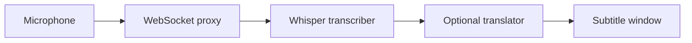

# Suntitle

Suntitle turns live speech into subtitles: capture microphone audio, transcribe
it with Whisper, optionally translate it, and display it in an always-on-top
subtitle window.



The proxy relays each stage's output to the next connected consumer.

The web UI manages hosts, processing nodes, and extensions. Diamant is the host
agent that runs those nodes. The backend can run locally or on AWS while audio
processing runs on connected hosts.

## Quickstart

Run these commands from the repository root. You need Docker with Compose,
Rust **1.96 or newer** and Cargo, [just](https://just.systems/), `mkcert`, and
OpenSSL. Keep Docker running and port **80** available. Diamant's default build
includes a native desktop UI and needs the platform's GUI build dependencies.

```bash
just db-env          # create .env.local if it does not exist
# Edit .env.local: set ADMIN_USERNAME and a nonempty ADMIN_PASSWORD.
just generate-certs  # first launch only; installs the local mkcert CA
just local-stack
```

Open [http://localhost](http://localhost) and sign in with those administrator
credentials. The command starts the backend and UI in Compose, then registers a
headless Diamant agent named `local-host`. Use the UI to install and configure
nodes on that host. Starting the stack alone does not start audio capture.

Press **Ctrl+C** to stop the stack. Database and registry volumes are retained.
Changing bootstrap credentials later does not reset an existing account.

For live audio, you also need a microphone, PortAudio, and the Python node
dependencies. See [local development](docs/local-development.md) for the
standalone audio pipeline, first model downloads, and development commands.

## Documentation

| Guide | Contents |
| --- | --- |
| [Local development](docs/local-development.md) | Setup, running services, tests, backup, and reset |
| [Architecture](docs/architecture.md) | Components, data flow, storage, and deployment boundaries |
| [Internals](docs/internals.md) | Source map, reconciliation, Diamant, builds, and releases |
| [Contracts](docs/contracts.md) | HTTP API, Kubernetes resources, and WebSocket protocol |
| [Extensions](docs/extensions.md) | Source manifests, local registry, publication, and installation |
| [UI development](ui/README.md) | Vite, mock API, and Cypress |
| [AWS deployment](infrastructure/README.md) | Pulumi setup and operations |
