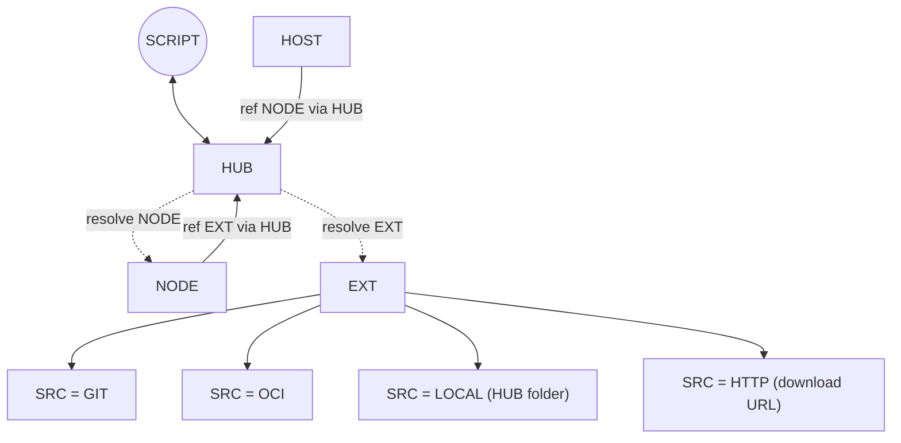
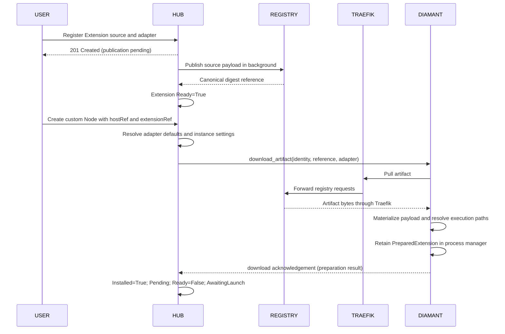
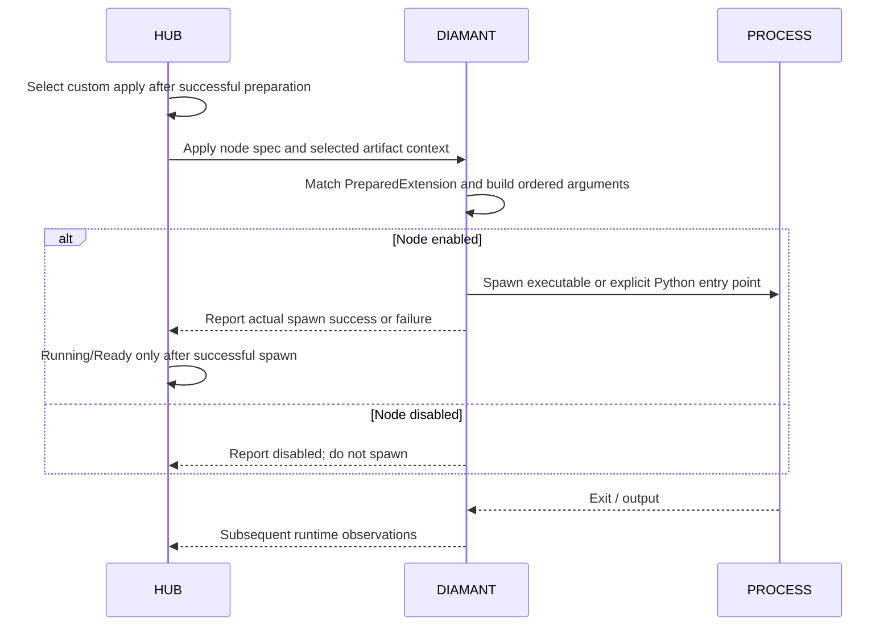

# Custom node execution and plugin contracts

## Outcome

Allow Diamant to run a custom component installed on its host. Custom components
MUST run directly unless their execution configuration explicitly selects Python.
They MUST accept arbitrary plugin settings through a declarative argument adapter
and implement the communication contract of their selected pipeline type.

Registration, publication, host preparation, argument construction, and custom
execution are implemented. Successful installation transitions through
`Installed=True`, phase `Pending`, into apply. Enabled nodes launch native binaries
directly or Python scripts/modules through embedded UV. Disabled nodes do not spawn.
Recovery automation, complete API-to-process acceptance coverage, and UI integration
remain outstanding; implementation completion does not imply those checks passed.

The first working milestone is a self-contained executable created through the
API, assigned to a host, and launched with mapped flags. UI support is a separate
user-facing milestone. Python dependency installation and advanced argument modes
are later work; neither blocks the self-contained executable milestone.

## Extension specification and node instances

An extension describes the installation source and execution adapter for a custom
plugin. Automatic prerequisite installation is a later capability. The adapter YAML is the extension specification. It defines the
plugin's type, execution, settings, and CLI mappings without a separate plugin
manifest or plugin-definition resource.

| Concept | Responsibility |
| --- | --- |
| Extension | Identifies the installation source and contains the adapter specification for type, entry point, runtime, settings, and CLI mappings |
| Node | References an extension when custom, supplies instance setting values, and runs on an assigned host under Diamant supervision |

The Node CR requires `extensionRef` for custom nodes. Built-in nodes omit it.

The lifecycle is:

1. Register an extension source and adapter through the Kubernetes-backed API.
2. Publish the source payload into Distribution in a background task.
3. Create a custom node with `extensionRef`, `hostRef`, and `settings.custom`.
4. Resolve defaults and overrides, then dispatch the artifact reference and adapter.
5. Diamant downloads the payload, resolves the entry point and working directory,
   and retains a prepared installation for that node. This is implemented.
6. Dispatch a custom apply after preparation, construct arguments, and launch
   through the existing process supervisor. This is implemented.

Extension specifications are reusable. Execution details and CLI mappings belong
to the extension; node-specific values and host assignment belong to the node.
Publication status belongs to the Extension CR. Installation and execution status
belong to the Node CR. A successful publication does not imply either installation
or execution, and `Installed=True` does not imply a running process or prepared
third-party dependencies.

The Extensions API is implemented. Its frontend still uses an older package model:
it submits `{sourceType, source}`, expects flat extension metadata and list arrays,
and offers local/Git/ZIP sources. The current API expects `{name?, spec}` with an
adapter, returns Kubernetes resources, and lists `{items, resourceVersion}`.
The browser file picker sends a filename, not file contents. Align these models
before claiming that users can create extensions through the UI. Dynamic plugin
discovery is unnecessary: the registered adapter explicitly defines the plugin.

## Node, host, and extension dependencies

Extension is a Kubernetes custom resource backing the Extensions API. The
extension controllers reconcile publication and node dependencies through HUB.
HUB is the API and ws-proxy, including their controller logic. Custom nodes
reference extensions through HUB. HUB resolves node and extension resources
for hosts rather than requiring hosts to access those resources directly.



Supported extension source types are:

| Source type | Meaning |
| --- | --- |
| `git` | Git repository |
| `oci` | OCI artifact |
| `local` | Local folder on HUB |
| `http` | Download from an HTTP or HTTPS URL |

A local source refers to HUB's filesystem, not the user's browser or the assigned
host. HUB MUST make the required source contents available for host preparation.
HTTP identifies the download mechanism; an archive format such as ZIP is not a
separate source type. The backend already supports these four source types. The frontend still offers
local/Git/ZIP and must be aligned. HTTP responses remain executable files; ZIP
URLs are not automatically unpacked. Git currently uses HTTP(S), default `HEAD`,
and a depth-one bare snapshot; SSH, submodules, and LFS resolution are deferred.

## Registry distribution and local installation

The configured Distribution registry MUST be both the destination for prepared
extensions and the source for distributing them to custom nodes. Every original
source, including local HUB folders, HTTP, Git, and upstream OCI, is published
by the extension controller into Distribution. Local and Git payloads are packaged with the adapter; HTTP responses are
published as single executable files with the adapter retained in the Extension spec; upstream OCI artifacts are streamed directly
into Distribution. Source transfer and publication follow the
[extension reconciler plan](extension-reconciler-plan.md#source-preparation-and-streaming-publication).
Nodes MUST obtain extension payloads from this registry rather than the original
source.

```text
Original source (local / HTTP / Git / OCI / ...)
    -> HUB preparation
    -> Structured artifact in Distribution
    -> Traefik registry endpoint
    -> Diamant installation on the assigned host
    -> Local extension folder
    -> Custom apply and ordered argument construction
    -> Native execution or embedded-UV Python execution under supervision
```

Distribution is accessible to Diamant through Traefik. HUB supplies a prepared
artifact reference using that reachable registry endpoint. Diamant downloads the
artifact through Traefik to bootstrap the extension on its host. It installs its
contents as a local file or folder and resolves execution paths. Dependency
preparation and process launch are separate stages. Entry points and working directories resolve against that installation
according to the adapter contract. OCI distribution does not imply container execution.

Publication, host installation, and node execution have separate outcomes.
Installation failure MUST prevent launch and expose an actionable error.

The [extension reconciler plan](extension-reconciler-plan.md) defines background
preparation, OCI client integration, and Distribution deployment details.

## Registration, preparation, and execution sequence

The implemented preparation path precedes custom apply:



After installation succeeds, the planner selects custom apply. The following
execution sequence is implemented; a complete API-driven acceptance test remains
outstanding:



Reuse the existing apply/reporting and supervision machinery. Command acceptance
alone MUST NOT mark a node running. Installation failures remain distinct from
argument-construction and process-start failures.

## Existing Extension and Node contracts

These examples use the current resource shape. Custom launch reuses existing
Node status and acknowledgement contracts. Host apply messages carry optional
custom context containing the artifact reference and current resolved adapter.

### Extension

```yaml
apiVersion: control.suntitle.io/v1alpha1
kind: SuntitleExtension
metadata:
  name: custom-transcriber
  namespace: suntitle
spec:
  name: Custom transcriber
  sourceType: local # local | git | oci | http
  source: /opt/suntitle/extensions/custom-transcriber
  refreshToken: <optional-refresh-request-token>
  adapter:
    type: transcriber
    execution:
      runtime: executable
      command: ./bin/transcriber
    settings:
      language:
        default: en
    arguments:
      - flag: --server
        source: runtime.websocketUrl
      - flag: --language
        source: settings.language
status:
  observedGeneration: 1
  taskId: <preparation-task-id>
  artifactReference: registry.example.com/suntitle/extensions/custom-transcriber@sha256:<manifest-hash>
  conditions:
    - type: Ready
      status: "True"
      observedGeneration: 1
      reason: ArtifactPublished
      message: Prepared extension artifact is available in the registry.
      lastTransitionTime: "2026-11-01T10:00:05Z"
```

`adapter` contains the extension specification described below. HUB MUST package
it as `adapter.yaml` at the extension directory root alongside local and Git
payloads. HTTP responses are single executable file artifacts; their adapter
remains in the Extension specification. Upstream OCI content is republished as-is.
Relative entry points and working directories resolve from that root; the default
working directory is the installed extension root.

The API accepts `{name?, spec}` for registration and returns the created resource.
Lists return `{items, resourceVersion}`. Refresh patches `spec.refreshToken` with
an opaque new value and returns 202; this requests preparation without claiming
that publication or host installation has finished. Reconciliation MUST account
for the new generation, including refreshes with unchanged source contents.

Extension status uses the existing condition design. `Ready` means publication
only. While preparing, it is `False` with reason `Preparing`; on failure it is
`False` with an actionable reason and message. `artifactReference` is present only
for a successfully published current desired preparation. `taskId` connects the
resource to the in-memory executor; unknown tasks are resubmitted as described in
the reconciler plan. It is not a host installation status.

### Prepared custom Node

```yaml
apiVersion: control.suntitle.io/v1alpha1
kind: SuntitleNode
metadata:
  name: transcription
  namespace: suntitle
spec:
  name: Transcription
  hostRef:
    name: worker-1
  enabled: true
  inputRef:
    name: microphone
  extensionRef:
    name: custom-transcriber
  settings:
    custom:
      language: en
status:
  observedGeneration: 1
  phase: Pending
  message: Extension installed; awaiting argument construction and launch.
  conditions:
    - type: Installed
      status: "True"
      observedGeneration: 1
      reason: ExtensionInstalled
      message: Extension files and configured execution paths are ready on the assigned host.
      lastTransitionTime: "2026-11-01T10:01:05Z"
```

`extensionRef` follows the existing same-namespace `ResourceRef` pattern.
`settings.custom` adds arbitrary instance values alongside the existing built-in
settings variants. Custom nodes MUST require `extensionRef`; built-in variants
MUST omit it. The referenced adapter supplies the pipeline type, execution, and
argument mappings. `inputRef` is optional pipeline configuration. It MUST NOT gate
host installation or startup, trigger upstream resolution watches, or restart the
runnable when changed. Explicit pipeline validation and routing are separate work;
the current data plane broadcasts by role.

The Node depends on the referenced Extension being published and installed on its
assigned host before launch. The existing
Node status includes the `Installed` condition. It is `False` while preparing or after installation failure, with an
actionable reason and message. Built-in nodes omit it. Each referencing Node
records its assigned host's installation outcome; installation MAY be shared
internally without adding per-host results to the Extension.

Existing `dispatch`, `reportingSession`, `acknowledgedRestartToken`, phases, and
`Ready`/`Updated` conditions remain in use; the example omits unchanged fields.
Do not add separate installation or execution state objects. Preparation uses
`Pending`; installation failure uses `Failed`. Acceptance of an apply command alone
MUST NOT set `Running` or `Ready=True`; subsequent runtime observations determine
execution status using the existing Node status design.

The extension controller resolves defaults and node overrides and records the
resolved adapter and published artifact reference in Node status. Host dispatch
consumes that status.

HUB writes CR status from executor and Diamant observations. Existing resource,
operation, and session identity checks MUST also apply to extension preparation
and installation results. Conditions follow the existing Kubernetes condition
schema and MUST identify the observed resource generation.

## Independent configuration concerns

Keep execution, pipeline type, and plugin settings independent. A custom
transcriber participates in the pipeline as a transcriber; custom execution
determines how Diamant launches it.

| Concern | Required configuration | Responsibility |
| --- | --- | --- |
| Pipeline type | `audio_source`, `transcriber`, `translator`, or `display` | Communication contract and type-specific runtime endpoint |
| Execution | Runtime and entry point | Host process launch |
| Plugin settings | Arbitrary key/value object, which MAY be empty | Component-specific configuration |
| Argument adapter | Ordered bindings from settings and runtime values | CLI argument construction |
| Communication | Contract for the selected type | Frame types, payloads, and connection behavior |

Host assignment, enabled state, input reference, and restart controls remain node
configuration outside plugin settings. `execution.workingDirectory` already
defaults to the installed extension root. Environment-variable bindings are a
later feature, not part of the first launch milestone.

Custom settings MUST NOT inherit the built-in implementations' model, provider,
device, or presentation restrictions. Type requirements belong to the protocol
contract rather than a mandatory set of built-in CLI flags.

## Execution

Execution uses one required `command` field interpreted by `runtime`:

- `executable`: run `command` as a native executable path, without uv.
- `python`: pass `command` as a script path to Diamant's embedded uv/Python launcher.
- `pythonModule`: pass `command` as an importable module name using Python `-m`.

Examples of the shared execution shape:

```yaml
# Native binary
execution:
  runtime: executable
  command: ./transcriber
  workingDirectory: .
```

```yaml
# Python source file
execution:
  runtime: python
  command: ./transcriber.py
  workingDirectory: .
```

```yaml
# Python module; launched through embedded UV with python -m
execution:
  runtime: pythonModule
  command: my_plugin.transcriber
  workingDirectory: .
```

`command` is a single path or module name, not a shell command line. Plugin flags
continue to come from the ordered adapter argument bindings. Both Python runtime
variants use Diamant's embedded UV launcher. Native executable mode bypasses UV.

Diamant MUST preserve the existing process supervision behavior: output
forwarding, exit reporting, restart handling, graceful termination, and descendant
cleanup. Python MUST NOT be inserted into executable-mode commands.

Host preparation resolves `runtime` (default `executable`), the required `command`,
and optional `workingDirectory` from the adapter's typed `ExecutionSpec`. File entry points and working directories must exist;
Unix native entry points must have executable permissions. Python module imports
are not tested during installation. Current dependencies must be supplied by the
payload or host; automatic dependency preparation is deferred.

Declared and resolved adapters reuse `Adapter<S>`: setting declarations and
resolved user values are the only differing payload. Both use the same
`ExecutionSpec`, `ExecutionCommand`, and `ArgumentBinding` contracts. Host
preparation reuses `ExecutionCommand` with resolved file paths or the original
module name rather than defining another runtime enum.
`runtime` defaults to `executable` during deserialization and schema defaulting.
All runtimes require a nonempty `command`. Its meaning is selected explicitly by
`executable`, `python`, or `pythonModule`; there is no inference from file suffixes. Unknown standard fields and invalid combinations are rejected by typed
deserialization and constrained Kubernetes/OpenAPI schemas.

Argument sources reuse `ArgumentSource`: reserved runtime values use `RuntimeValue`
and plugin bindings retain the exact user-defined setting key. The API/YAML source
strings remain `runtime.websocketUrl` and `settings.<key>`; string parsing happens
once during deserialization. Only plugin-owned values remain arbitrary JSON via
`PluginSettings` and setting defaults. Installation failures MUST remain separate
from argument-building and process-start failures.

## Declarative CLI adapter

The adapter translates configuration into an ordered argument array. It MUST NOT
construct a shell command or evaluate shell expressions.

Example extension adapter specification for a custom transcriber. Settings
declare defaults or whether an instance value is required:

```yaml
type: transcriber
execution:
  runtime: executable
  command: /opt/plugins/my-transcriber

settings:
  model:
    default: fast
  threads:
    default: 4
  useGpu:
    default: true
  language:
    required: true
  device:
    required: false

arguments:
  - flag: --server
    source: runtime.websocketUrl
  - flag: --model-name
    source: settings.model
  - flag: --workers
    source: settings.threads
  - flag: --gpu
    source: settings.useGpu
    mode: switch
  - flag: --language
    source: settings.language
  - flag: --device
    source: settings.device
```

With a resolved endpoint of `wss://proxy/transcribe`, an instance language of
`en`, and no device value, the argument array is:

```json
[
  "--server", "wss://proxy/transcribe",
  "--model-name", "fast",
  "--workers", "4",
  "--gpu",
  "--language", "en"
]
```

Settings have three cases:

| Declaration | Behavior when the node omits the setting |
| --- | --- |
| `default` provided | Use the default; the node MAY override it |
| No default and `required: true` | Reject the missing required value |
| No default and `required` omitted or `false` | Leave the setting absent and omit its argument binding |

`required` defaults to false. Declaring a default supplies a value without
`required: true`; defaults apply regardless of the required flag.

An absent optional setting MUST omit both its flag and value. Explicit null,
`false`, zero, and empty strings MUST NOT be treated as absence. In particular,
checking for a default MUST use field presence rather than its truthiness.

The initial implementation must handle the existing schema: positional bindings,
separate flag/value arguments, boolean switches, defaults, and optional omission.

Later argument extensions MAY add:

- Literal arguments independent of settings/runtime sources.
- Joined `--flag=value` arguments.
- Repeated list arguments.
- Explicit JSON serialization of structured values.
- Environment-variable bindings.

Settings MAY contain arbitrary JSON values. Each binding MUST define an
unambiguous conversion to arguments. Objects MUST require explicit serialization;
they MUST NOT silently become strings. Missing values MUST remain distinguishable
from `false`, zero, and empty strings. Boolean switch mode emits the flag for
`true` and omits it for `false`.

The current CRD represents `arguments` as an ordered list. Preserve that order
when constructing the argument array; no ordering indices or sorting rules are
needed. Advanced conversion modes remain deferred.
The initial schema supports `source`, optional `flag`, and `mode: value | switch`.
The default mode is `value`. Omitting `flag` represents a positional value;
`switch` requires a flag through a CRD CEL rule. Sources use
`settings.<key>` or `runtime.websocketUrl`. Source keys are exact setting names.
Literal, joined, repeated, and explicit JSON argument conversion remain pending.
Values containing spaces or shell characters MUST remain individual arguments.

Extension settings and arguments belong to the extension; nodes supply only
`settings.custom` overrides. Execution resolution overlays those values on
extension defaults without writing inherited values into the Node CR. Mappings,
pipeline type, and execution configuration come from the extension. Resolution
reports missing required settings; omitted optional settings omit their mappings.
Explicit null defaults and overrides remain present, as do false, zero, and empty
strings. Undeclared instance keys remain unrestricted custom settings. Resolving
defaults does not generate CLI strings or launch a process. Host apply delivers
the resolved adapter, and Diamant constructs ordered arguments. Value bindings
accept strings, numbers, and booleans; null, arrays, and objects fail argument
construction. Switch bindings require booleans. Optional absent bindings are
removed during resolution.

Diamant supplies a reserved runtime context independently of plugin settings.
Initially, it MUST provide the full type-specific `runtime.websocketUrl`,
including the `ws` or `wss` scheme and endpoint path. Plugin settings MUST NOT
override runtime values.

Every runtime value required by the type contract MUST have a declared delivery
binding. CLI arguments are the primary mechanism; environment bindings MAY also
be supported. A plugin MAY choose its own flag or environment variable names.

The adapter maps configuration only. A component using a different communication
protocol requires a wrapper that implements the Suntitle type contract.

## WebSocket contract reference

Plugins act as WebSocket clients and connect to proxy endpoints. They do not
need to host WebSocket servers.

| Type | Proxy endpoint | Plugin receives | Plugin sends |
| --- | --- | --- | --- |
| Audio source | `/` | No required application input | Binary audio frames |
| Transcriber | `/transcribe` | Binary audio frames | UTF-8 transcription text |
| Translator | `/translate` | UTF-8 transcription text | UTF-8 translated text |
| Display | `/display` | Subtitle text | No required application output |

Publish a readable reference for each supported type. It
MUST specify:

- Connection direction and the resolved endpoint supplied by Diamant.
- Required send and receive operations.
- WebSocket frame types and application message boundaries.
- Payload format, including audio encoding and sample rate where applicable.
- Supported control messages and close behavior.
- Reconnection responsibilities and shutdown expectations.
- Example exchanges suitable for implementing a plugin in any language.

The reference MUST describe and test actual supported behavior. The extension
specification does not declare a protocol version.

The node configuration UI SHOULD show the selected type's contract and how its
required runtime values map to the plugin's arguments. Any UI design change
requires a shadcn/ui proposal in the Suntitle Figma file and explicit approval
before implementation, following the project workflow.

## Implementation progress

### Completed path: registration through installation

- [x] Add Extension and custom Node resource/API fields, CRD generation, and RBAC.
- [x] Persist extension registration and refresh requests in Kubernetes.
- [x] Resolve adapter defaults, required settings, optional bindings, and node overrides.
- [x] Reuse typed adapter, execution, entry-point, argument-source, and plugin-settings contracts across registration, resolution, dispatch, and host preparation; regenerate CRD/OpenAPI schemas.
- [x] Publish local, HTTP, Git HTTP(S), and upstream OCI sources through the background executor. Source implementation belongs to the [extension reconciler plan](extension-reconciler-plan.md).
- [x] Expose Distribution through Traefik and dispatch canonical artifact references.
- [x] Dispatch the resolved adapter with the artifact reference.
- [x] Download and materialize payloads on the assigned Diamant host.
- [x] Resolve native/Python entry points and working directories; retain `PreparedExtension` for its node.
- [x] Hand the prepared installation to the process manager without starting a process.
- [x] Report `Installed=True` with reason `ExtensionInstalled`, while `Ready/Updated=False` with reason `AwaitingLaunch` and phase `Pending`; report preparation failures separately.
- [x] Preserve current resource/session checks, background downloads, cancellation, and removal of prepared associations.

### Completed execution and reconfiguration

- [x] Select custom apply after successful installation and deliver the Node spec, artifact reference, and resolved adapter.
- [x] Supply full type-specific `runtime.websocketUrl` values for all four pipeline types, preserving scheme, port, and path prefix.
- [x] Build ordered `OsString` arguments with positional values, separate flags, boolean switches, defaults, and optional omission. Preserve false, zero, empty strings, and shell characters; reject null and structured values without explicit conversion.
- [x] Launch prepared native executables directly from their configured working directory through the shared `NodeProcessManager::apply` supervisor. Disabled nodes MUST NOT spawn.
- [x] Launch Python scripts/modules through embedded UV, using the prepared working directory and adapter arguments. Automatic dependency preparation is separate.
- [x] Reprovision changed extensions on HUB and consume the published artifact reference on the Node. A changed reference invalidates bootstrap; unchanged references retain installed files.
- [x] Apply command/settings changes and explicit restarts without pulling unchanged artifacts. Compare typed runnable spec fields and effective commands; CEL-immutable host assignment and settings type participate in equality, while display metadata and pipeline input references do not.
- [x] Restore installations after reconnect using payloads cached by artifact reference; pull again only when the payload is unavailable locally or the selected reference is uncached.
- [x] Report actual spawn results and subsequent process exits. Preserve installation status after argument or launch failure when the payload remains valid.
- [x] Keep `inputRef` as pipeline configuration without startup validation, dependency watches, or process restarts.

### Remaining: recovery and acceptance

- [ ] Automatic recovery: add bounded retries for transient download failures and decide whether crashed processes restart automatically or require an explicit restart.
- [ ] Complete acceptance coverage: verify extension registration → publication → host installation → actual native and embedded-UV Python execution, including refresh, command/settings updates, reconnect, disable, restart, failure, and deletion.

### Remaining: user-facing workflow

- [ ] Align frontend extension models with `{name?, spec}`, Kubernetes resource responses, and `{items, resourceVersion}` list responses. Replace ZIP with HTTP/OCI source choices and support adapter configuration and publication status.
- [ ] Add custom-node UI controls for extension, host, instance settings, and installation/running status. A browser file picker MUST NOT imply an upload when it sends only a filename: local sources refer to HUB directories; browser content upload needs a separate future contract.
- [ ] Follow the required shadcn/ui Figma review for UI design changes, then implement the approved design, update mocks, and run Cypress coverage.
- [ ] Publish a runnable plugin example and a concise reference for actual audio/text WebSocket payloads and endpoint bindings. Complete the user acceptance test through the UI once those controls exist.

### Deferred work, not a blocker for the executable milestone

- [ ] Define and implement automatic Python/package/native dependency preparation, including its failure and readiness semantics. Until then, `Installed=True` means payload and execution paths are prepared, not that dependencies were installed.
- [ ] Add literal arguments, joined flags, repeated list arguments, explicit JSON conversion, and environment bindings when a concrete plugin requires them.
- [ ] Add Git SSH, configurable refs, submodules, or LFS only when requested. Current Git HTTP(S)/default-HEAD behavior is intentional.
- [ ] Add host registry authentication and cache cleanup when required by deployment. Current host registry access is anonymous; artifact reuse is implemented.

## Validation and completion criteria

Already covered by existing tests:

- [x] Adapter default/override resolution and resource contract behavior.
- [x] Publication executor identity and result notification behavior; Git depth-one snapshot packaging and cleanup.
- [x] Controller delivery of artifact reference and resolved adapter.
- [x] Host download, payload-path resolution, installation handoff, missing-entry-point failure, heartbeats, and cancellation.
- [x] Preparation succeeds without starting a process; `Installed` and runtime readiness remain separate.
- [x] Post-installation custom apply selection, artifact replacement, and rejection of stale reports.
- [x] Native process supervision, unchanged-command reuse, argument updates, disable, and removal.
- [x] Full endpoint URLs and embedded-UV script/module command construction; scalar and switch argument validation.
- [x] Configuration changes retain installation; unchanged published content retains bootstrap state; cached payloads can be restored while the registry is unavailable.
- [x] Typed runnable equality includes immutable host/type configuration and excludes display metadata and pipeline inputs.

Outstanding acceptance and release checks:

- [ ] End-to-end native launch with exact flags and full runtime WebSocket URL.
- [ ] Verify explicit pipeline routing separately when implemented; `inputRef` does not currently route data or gate startup.
- [ ] Disabled nodes remain stopped; a setting/restart/artifact change runs the current intended payload.
- [ ] Argument-building failure, spawn failure, and process exit produce the corresponding runtime status without erasing valid installation status.
- [ ] Actual custom Python script/module execution through embedded UV, beyond command construction.
- [ ] Browser create/configure/start workflow and Cypress tests before claiming UI support.
- [ ] Static Linux server and Diamant build verification before declaring a complete static release; see the publication plan delivery checks.

Use the existing test suites rather than introducing another registry emulator.
Relevant coverage lives in `tests/extension_adapter.rs`, controller tests,
`tests/diamant_artifacts.rs`, and the OCI artifact tests. Publication/ORAS
interoperability checks do not substitute for an API-to-running-process test.
Run relevant Rust tests, formatting, and Clippy when implementation changes;
run Cypress after UI changes. This plan review changes documentation only.

## Existing code

- [Diamant process supervision and command construction](../ws-proxy/src/diamant/nodes.rs)
- [Node resources and settings](../ws-proxy/src/kubernetes/resources.rs)
- [Node-type catalog](../ws-proxy/src/api/node_types.rs)
- [WebSocket proxy routes](../ws-proxy/src/main.rs)
- [Kubernetes-backed Extension API](../ws-proxy/src/api/extensions.rs)
- [Extensions frontend](../ui/src/pages/extensions-page.tsx)
- [Custom dispatch selection](../ws-proxy/src/controller/plan.rs)
- [Prepared installation paths](../ws-proxy/src/diamant/installation.rs)

## Diamant download and installation contract

Host dispatch sends `download_artifact` with the existing `ApplyIdentity`, the
published `reference`, and the resolved `adapter`. Both publication and adapter
resolution MUST be current before dispatch. The reference contains the registry
and repository; the OCI client supplies `/v2/`. Registry authentication is initially
anonymous; HTTPS is the default, with explicit host configuration for plain HTTP.

The downloader returns the restored file or directory path from the layer's OCI
filename annotation. Diamant uses that directory as the installation root, or the
parent directory for a single-file HTTP payload. `execution.workingDirectory`
defaults to the installation root. Relative execution paths resolve from that root.
All runtimes use `execution.command`. `executable` and `python` resolve it as a
file path; `pythonModule` retains it as an importable module name. The host resolves file entry points and
working directories before reporting success. It does not construct arguments,
prepare dependencies, import Python modules, or start a process in this stage.

A prepared installation associates the node identity and artifact reference with
its adapter, local root, entry point, and working directory. Diamant hands this
record to its process manager, where it awaits argument construction and launch.
Removal and session shutdown clear these host-local associations.

Dispatch records operation `download` and an `artifactReference` snapshot. Reports
use the existing acknowledgement envelope. A successful acknowledgement now means
both download and installation-path preparation completed: `Installed=True`, reason
`ExtensionInstalled`; `Ready=False` and `Updated=False`, reason `AwaitingLaunch`;
phase `Pending`. Preparation failure sets `Installed=False` and phase `Failed`,
reason `ExtensionPreparationFailed`. Neither outcome claims process startup.
Resource, generation, operation, artifact, and session checks still reject stale
reports. Successful preparation is followed by custom apply. Only prerequisite
preparation remains deferred at this boundary.

Diamant uses configurable persistent local artifact storage, defaulting to the OS
local data directory under `suntitle/diamant/artifacts`. Every download uses private
staging and publishes a unique directory after completion. Failed/cancelled staging
MUST be removed after renderer shutdown. Completed downloads are retained and
indexed by artifact reference. Reconnect restores a cached payload without a
registry pull when it remains available. Command-only changes re-resolve execution
paths against the existing installation without repeating the pull stage.
Garbage collection and automatic download retries remain outstanding.
Background download jobs MUST NOT block registration heartbeats and
MUST be cancelled and awaited on removal, replacement, disconnect, or shutdown.
