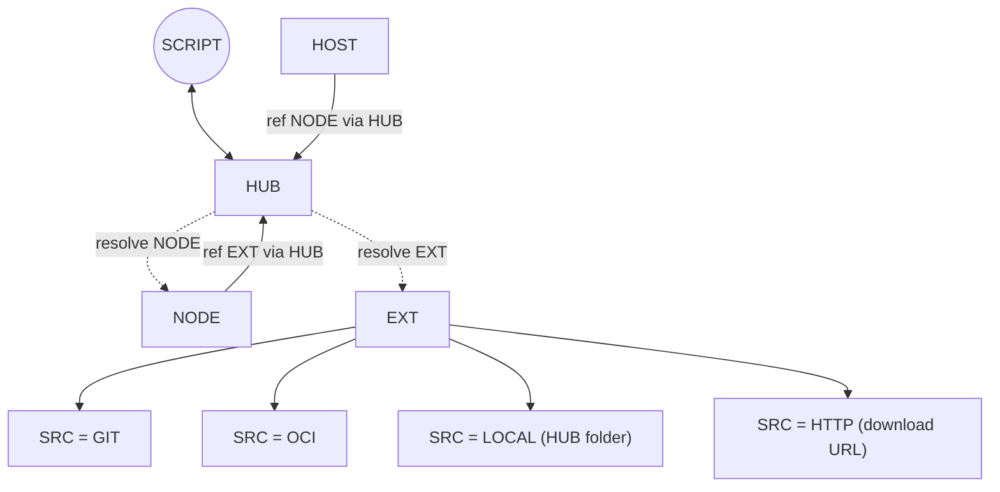
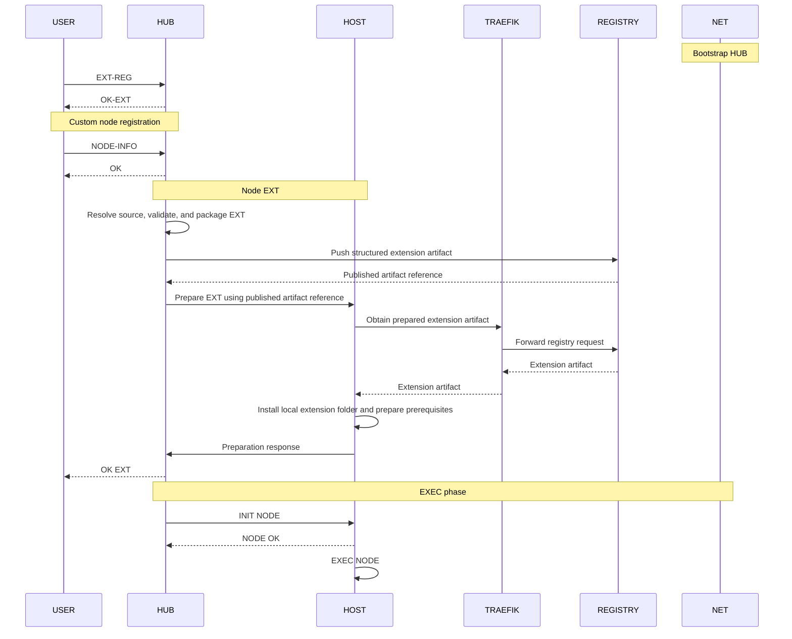

# Custom node execution and plugin contracts

## Outcome

Allow Diamant to run a custom component installed on its host. Custom components
MUST run directly unless their execution configuration explicitly selects Python.
They MUST accept arbitrary plugin settings through a declarative argument adapter
and implement the communication contract of their selected pipeline type.

This document is a proposal. It does not introduce API contracts or implementation
changes. The configuration examples describe the intended model, not an existing
API payload.

## Extension specification and node instances

An extension describes the installation source for custom plugins and their
prerequisites. The adapter YAML is the extension specification. It defines the
plugin's type, execution, settings, and CLI mappings without a separate plugin
manifest or plugin-definition resource.

| Concept | Responsibility |
| --- | --- |
| Extension | Identifies the installation source and contains the adapter specification for type, entry point, runtime, settings, and CLI mappings |
| Node | References an extension when custom, supplies instance setting values, and runs on an assigned host under Diamant supervision |

The Node CR MUST gain an extension reference for custom nodes. Built-in nodes
do not require an extension reference.

The lifecycle is:

1. Register an extension and its installation source.
2. Resolve the source, validate the adapter, and prepare a structured extension artifact.
3. Publish the prepared artifact to the configured Distribution registry.
4. Create or configure a node referencing that extension.
5. Have Diamant obtain the prepared artifact and materialize a local folder
   on the assigned host, then prepare its prerequisites.
6. Launch the node through Diamant after host preparation succeeds.

Extension specifications SHOULD be reusable across nodes. Execution details and
CLI mappings belong to the extension; node-specific values belong to the instance.
The artifact representation and proposed resource contracts are defined below.
Host installation details and extension update behavior still require concrete contracts. Success and failure MUST be recorded in the corresponding CR status:
extension preparation results on the Extension CR and node execution results on
the Node CR.

The existing Extensions frontend lists package metadata and offers installation
and refresh requests. Its backend handlers are placeholders, and local file
selection currently submits a filename or path rather than uploading contents.
Implementing host installation, dependency preparation, and plugin discovery is
required to complete this lifecycle. The Extensions UI manages package sources
and adapter specifications; node configuration references extensions and supplies
instance values.

## Node, host, and extension dependencies

Extension MUST be introduced as a new Kubernetes custom resource backing the
current stub Extensions API. Add controller logic to reconcile extension
resources and coordinate source resolution and host preparation through HUB.
HUB is the API and ws-proxy, including their controller logic. Custom nodes
reference extensions through HUB. HUB resolves node and extension resources
for hosts rather than requiring hosts to access those resources directly.



Supported extension source types are:

| Source type | Meaning |
| --- | --- |
| `git` | Git repository |
| `oci` | OCI artifact |
| `local` | Local folder on HUB |
| `http` | Download from an HTTP or HTTPS URL |

A local source refers to HUB's filesystem, not the user's browser or the assigned
host. HUB MUST make the required source contents available for host preparation.
HTTP identifies the download mechanism; an archive format such as ZIP is not a
separate source type. The existing stub API exposes local, Git, and ZIP sources;
its source contract and frontend MUST be aligned with these four source types.

## Registry distribution and local installation

The configured Distribution registry MUST be both the destination for prepared
extensions and the source for distributing them to custom nodes. Every original
source, including local HUB folders, HTTP, Git, and upstream OCI, passes through
HUB preparation into a structured artifact containing the adapter and payload.
Nodes MUST obtain extension payloads from this registry rather than the original
source.

```text
Original source (local / HTTP / Git / OCI / ...)
    -> HUB preparation
    -> Structured artifact in Distribution
    -> Traefik registry endpoint
    -> Diamant installation on the assigned host
    -> Local extension folder
    -> Prerequisite preparation and custom node execution
```

Distribution is accessible to Diamant through Traefik. HUB supplies a prepared
artifact reference using that reachable registry endpoint. Diamant downloads the
artifact through Traefik to bootstrap the extension on its host. It installs its
contents as a real local folder before preparing prerequisites and launching the
custom node. Entry points and working directories resolve against that installation
according to the adapter contract. OCI distribution does not imply container execution.

Publication, host installation, and node execution have separate outcomes.
Installation failure MUST prevent launch and expose an actionable error.

The [extension reconciler plan](extension-reconciler-plan.md) defines background
preparation, OCI client integration, and Distribution deployment details.

## Registration, preparation, and execution sequence



`NODE OK` acknowledges acceptance of `INIT NODE` only. Execution happens later.
It MUST NOT be interpreted as process startup or successful execution. Success
and failure are always reported through the corresponding Extension or Node CR
status; acknowledgements do not replace those status updates.

## Proposed Extension and Node contracts for review

These YAML examples define the proposed resource and API fields. Implementation
MUST reuse the existing Kubernetes resource, API model, and condition patterns.
They are additions to the current Node contract, not a replacement lifecycle.

### Extension

```yaml
apiVersion: control.suntitle.io/v1alpha1
kind: SuntitleExtension
metadata:
  name: custom-transcriber
  namespace: suntitle
spec:
  name: Custom transcriber
  sourceType: local # local | git | oci | http
  source: /opt/suntitle/extensions/custom-transcriber
  adapter:
    type: transcriber
    execution:
      runtime: executable
      executable: ./bin/transcriber
    settings:
      language:
        default: en
    arguments:
      - flag: --server
        source: runtime.websocketUrl
      - flag: --language
        source: settings.language
status:
  observedGeneration: 1
  taskId: <preparation-task-id>
  artifactReference: registry.example.com/suntitle/extensions/custom-transcriber@sha256:<manifest-hash>
  conditions:
    - type: Ready
      status: "True"
      observedGeneration: 1
      reason: ArtifactPublished
      message: Prepared extension artifact is available in the registry.
      lastTransitionTime: "2026-11-01T10:00:05Z"
```

`adapter` contains the extension specification described below. HUB MUST package
it as `adapter.yaml` at the extension directory root alongside the source payload.
Relative entry points and working directories resolve from that root; the default
working directory is the installed extension root.

Extension status uses the existing condition design. `Ready` means publication
only. While preparing, it is `False` with reason `Preparing`; on failure it is
`False` with an actionable reason and message. `artifactReference` is present only
for a successfully published current desired preparation. `taskId` connects the
resource to the in-memory executor; unknown tasks are resubmitted as described in
the reconciler plan. It is not a host installation status.

### Custom Node additions

```yaml
apiVersion: control.suntitle.io/v1alpha1
kind: SuntitleNode
metadata:
  name: transcription
  namespace: suntitle
spec:
  name: Transcription
  hostRef:
    name: worker-1
  enabled: true
  inputRef:
    name: microphone
  extensionRef:
    name: custom-transcriber
  settings:
    custom:
      language: en
status:
  observedGeneration: 1
  phase: Running
  message: Custom transcriber process is running.
  conditions:
    - type: Installed
      status: "True"
      observedGeneration: 1
      reason: PreparationSucceeded
      message: Extension files and prerequisites are ready on the assigned host.
      lastTransitionTime: "2026-11-01T10:01:05Z"
```

`extensionRef` follows the existing same-namespace `ResourceRef` pattern.
`settings.custom` adds arbitrary instance values alongside the existing built-in
settings variants. Custom nodes MUST require `extensionRef`; built-in variants
MUST omit it. The referenced adapter supplies the pipeline type, execution, and
argument mappings. Input compatibility MUST use that pipeline type.

The Node depends on the referenced Extension being published and installed on its
assigned host before launch. Add only the `Installed` condition to the existing
Node status. It is `False` while preparing or after installation failure, with an
actionable reason and message. Built-in nodes omit it. Each referencing Node
records its assigned host's installation outcome; installation MAY be shared
internally without adding per-host results to the Extension.

Existing `dispatch`, `reportingSession`, `acknowledgedRestartToken`, phases, and
`Ready`/`Updated` conditions remain in use; the example omits unchanged fields.
Do not add separate installation or execution state objects. Preparation uses
`Pending`; installation failure uses `Failed`. Acceptance of `INIT NODE` alone
MUST NOT set `Running` or `Ready=True`; subsequent runtime observations determine
execution status using the existing Node status design.

HUB writes CR status from executor and Diamant observations. Existing resource,
operation, and session identity checks MUST also apply to extension preparation
and installation results. Conditions follow the existing Kubernetes condition
schema and MUST identify the observed resource generation.

## Independent configuration concerns

Keep execution, pipeline type, and plugin settings independent. A custom
transcriber participates in the pipeline as a transcriber; custom execution
determines how Diamant launches it.

| Concern | Required configuration | Responsibility |
| --- | --- | --- |
| Pipeline type | `audio_source`, `transcriber`, `translator`, or `display` | Input compatibility and communication contract |
| Execution | Runtime and entry point | Host process launch |
| Plugin settings | Arbitrary key/value object, which MAY be empty | Component-specific configuration |
| Argument adapter | Ordered bindings from settings and runtime values | CLI argument construction |
| Communication | Contract for the selected type | Frame types, payloads, and connection behavior |

Host assignment, enabled state, input reference, and restart controls remain node
configuration outside plugin settings. Working directory and environment MAY be
provided as execution settings. Omitted working directories MUST resolve to a
documented host default.

Custom settings MUST NOT inherit the built-in implementations' model, provider,
device, or presentation restrictions. Type requirements belong to the protocol
contract rather than a mandatory set of built-in CLI flags.

## Execution

Support two explicit execution modes initially:

- `executable`: launch a host-installed executable directly.
- `python`: launch a Python script or module through Diamant's Python launcher.

Diamant MUST preserve the existing process supervision behavior: output
forwarding, exit reporting, restart handling, graceful termination, and descendant
cleanup. Python MUST NOT be inserted into executable-mode commands.

Executable paths and Python entry points MUST resolve to components available on
the assigned host before launch. An extension can install those components and
prepare their prerequisites; manual installation is not required by this model.
Installation failures MUST be reported separately from node launch failures.

## Declarative CLI adapter

The adapter translates configuration into an ordered argument array. It MUST NOT
construct a shell command or evaluate shell expressions.

Example extension adapter specification for a custom transcriber. Settings
declare defaults or whether an instance value is required:

```yaml
type: transcriber
execution:
  runtime: executable
  executable: /opt/plugins/my-transcriber

settings:
  model:
    default: fast
  threads:
    default: 4
  useGpu:
    default: true
  language: {}
  device:
    required: false

arguments:
  - flag: --server
    source: runtime.websocketUrl
  - flag: --model-name
    source: settings.model
  - flag: --workers
    source: settings.threads
  - flag: --gpu
    source: settings.useGpu
    mode: switch
  - flag: --language
    source: settings.language
  - flag: --device
    source: settings.device
```

With a resolved endpoint of `wss://proxy/transcribe`, an instance language of
`en`, and no device value, the argument array is:

```json
[
  "--server", "wss://proxy/transcribe",
  "--model-name", "fast",
  "--workers", "4",
  "--gpu",
  "--language", "en"
]
```

Settings have three cases:

| Declaration | Behavior when the node omits the setting |
| --- | --- |
| `default` provided | Use the default; the node MAY override it |
| No default and `required` omitted or `true` | Reject the missing required value |
| No default and `required: false` | Leave the setting absent and omit its argument binding |

An absent optional setting MUST omit both its flag and value. Explicit null,
`false`, zero, and empty strings MUST NOT be treated as absence. In particular,
checking for a default MUST use field presence rather than its truthiness.

The adapter SHOULD support:

- Literal arguments and positional values.
- Separate flag/value arguments and joined `--flag=value` arguments.
- Boolean switches and explicit boolean values.
- Repeated arguments for lists, preserving list order.
- Required bindings, defaults, and omission of absent optional values.
- Explicit JSON serialization for objects and other structured values.

Settings MAY contain arbitrary JSON values. Each binding MUST define an
unambiguous conversion to arguments. Objects MUST require explicit serialization;
they MUST NOT silently become strings. Missing values MUST remain distinguishable
from `false`, zero, and empty strings. Boolean switch mode emits the flag for
`true` and omits it for `false`.

Bindings MUST preserve their configured order. Unknown references, missing
required values, and incompatible value types MUST fail validation before launch.
Values containing spaces or shell characters MUST remain individual arguments.

Diamant supplies a reserved runtime context independently of plugin settings.
Initially, it MUST provide the full type-specific `runtime.websocketUrl`,
including the `ws` or `wss` scheme and endpoint path. Plugin settings MUST NOT
override runtime values.

Every runtime value required by the type contract MUST have a declared delivery
binding. CLI arguments are the primary mechanism; environment bindings MAY also
be supported. A plugin MAY choose its own flag or environment variable names.

The adapter maps configuration only. A component using a different communication
protocol requires a wrapper that implements the Suntitle type contract.

## WebSocket contract reference

Plugins act as WebSocket clients and connect to proxy endpoints. They do not
need to host WebSocket servers.

| Type | Proxy endpoint | Plugin receives | Plugin sends |
| --- | --- | --- | --- |
| Audio source | `/` | No required application input | Binary audio frames |
| Transcriber | `/transcribe` | Binary audio frames | UTF-8 transcription text |
| Translator | `/translate` | UTF-8 transcription text | UTF-8 translated text |
| Display | `/display` | Subtitle text | No required application output |

Publish a readable reference for each supported type. It
MUST specify:

- Connection direction and the resolved endpoint supplied by Diamant.
- Required send and receive operations.
- WebSocket frame types and application message boundaries.
- Payload format, including audio encoding and sample rate where applicable.
- Supported control messages and close behavior.
- Reconnection responsibilities and shutdown expectations.
- Example exchanges suitable for implementing a plugin in any language.

The reference MUST describe and test actual supported behavior. The extension
specification does not declare a protocol version.

The node configuration UI SHOULD show the selected type's contract and how its
required runtime values map to the plugin's arguments. Any UI design change
requires a shadcn/ui proposal in the Suntitle Figma file and explicit approval
before implementation, following the project workflow.

## Implementation progress

- [x] Add namespaced `SuntitleExtension` CRD with `local`, `git`, `oci`, and
  `http` source types, adapter object, and publication status fields.
- [x] Add optional same-namespace `extensionRef` to `SuntitleNode`.
- [x] Include Extension in generated CRDs, bootstrap, and API/controller RBAC.
- [x] Add arbitrary `settings.custom` and CRD rules requiring `extensionRef`
  for custom nodes, forbidding it for built-ins, and keeping the settings variant immutable.
- [ ] Back the placeholder Extensions API with Kubernetes resources.
- [ ] Finalize the adapter CRD schema and ordered argument binding syntax.
- [ ] Resolve local HUB folder sources into preparation inputs.
- [ ] Resolve Git sources into preparation inputs.
- [ ] Resolve HTTP download sources into preparation inputs.
- [ ] Resolve upstream OCI sources into preparation inputs.
- [ ] Package the adapter and payload using the ORAS directory convention.
- [ ] Add the in-memory preparation executor and completion notifications.
- [ ] Reconcile Extension preparation tasks, retries, and obsolete results.
- [ ] Push prepared artifacts to Distribution and record publication status.
- [ ] Configure Distribution access through Traefik.
- [ ] Deliver published artifact references to assigned Diamant hosts.
- [ ] Pull artifacts and materialize extension folders on Diamant hosts.
- [ ] Prepare host prerequisites and report the Node `Installed` condition.
- [ ] Resolve custom node pipeline types from referenced extensions for input compatibility.
- [ ] Construct ordered arguments from instance settings and runtime context.
- [ ] Launch custom executables under the existing Diamant process supervisor.
- [ ] Launch explicitly selected Python scripts or modules.
- [ ] Verify ORAS interoperability and the complete custom node lifecycle.

Validation MUST use regular CRD schema constraints. Do not add a separate adapter
validation layer. The initial adapter field preserves arbitrary JSON properties;
its detailed schema and CLI binding syntax remain pending. Custom nodes now use
`settings.custom` and MUST reference an extension. Diamant reports unsupported
custom execution until extension installation and launch are implemented.
The Extension CRD stores desired state and status; it does not prepare artifacts.

## Implementation sequence

1. Review the proposed Extension and Node YAML contracts above. Finalize the
   remaining argument binding syntax and type contracts while retaining
   independent type and execution concerns.
2. Extend API models, node-type metadata, Kubernetes schemas, validation, and mock
   fixtures. Add the Extension custom resource backing the stub Extensions API
   and controller reconciliation logic. Align source types with Git, OCI, local
   HUB folders, and HTTP downloads.
   Validate input compatibility using the selected pipeline type.
3. Implement extension source handling, plugin discovery, structured artifact
   publication to Distribution, and Diamant pull/materialization on assigned hosts.
   Add prerequisite preparation and separate publication/installation status reporting.
   Follow the [extension reconciler plan](extension-reconciler-plan.md).
4. Extend Diamant command construction with direct executable and explicit Python
   execution paths, runtime context resolution, and declarative argument binding.
5. Publish the type-specific WebSocket reference and verify example exchanges.
6. Propose the extension and node configuration UI in Figma. After approval,
   implement it with shadcn/ui and update relevant Cypress coverage.

## Validation

- Verify extension source handling, plugin discovery, and prerequisite preparation
  on the assigned host. Failed installation MUST prevent launch and expose an
  actionable installation error.
- Verify Git, OCI, local HUB folder, and HTTP download sources. Local paths MUST
  resolve on HUB, and downloaded archive formats MUST NOT be source types.
- Verify every original source produces a structured artifact in the configured
  registry, and Diamant uses that registry rather than the original source.
- Verify the prepared artifact becomes a usable local extension folder before
  launch. Publication alone MUST NOT report host installation as successful.
- Verify multiple nodes can reference a reusable extension while keeping
  their setting values independent.
- Verify built-in nodes need no extension reference and custom nodes require one.
- Verify defaulted, required without a default, and optional without a default
  settings, including omission of both flag and value for absent optional settings.
- Verify `NODE OK` reports acceptance only and subsequent preparation and execution
  results are recorded on the corresponding CR status.
- Verify direct executable launch and explicit Python launch independently.
- Verify ordered arguments, literal values, spaces, boolean modes, repeated
  values, defaults, optional omission, and explicit JSON serialization.
- Reject unknown references, missing required bindings, and invalid conversions.
- Verify full WebSocket URL delivery, including `wss` and endpoint paths.
- Exercise each type's documented send/receive contract with a custom component.
- Verify process exit reporting, restart, graceful shutdown, and descendant
  cleanup using the existing Diamant supervisor.
- Run relevant Rust tests and required formatting and lint checks when code is
  implemented. Run relevant Cypress tests after UI changes.

## Initial scope

The first version covers extension sources and host prerequisite installation,
reusable extension adapter specifications, explicit runtime selection, arbitrary plugin
settings, declarative CLI mapping, and the existing four types. Protocol
conversion remains a separate capability.

## Existing code

- [Diamant process supervision and command construction](../ws-proxy/src/diamant/nodes.rs)
- [Node resources and settings](../ws-proxy/src/kubernetes/resources.rs)
- [Node-type catalog](../ws-proxy/src/api/node_types.rs)
- [WebSocket proxy routes](../ws-proxy/src/main.rs)
- [Extension API contracts and placeholder handlers](../ws-proxy/src/api/extensions.rs)
- [Extensions frontend](../ui/src/pages/extensions-page.tsx)
