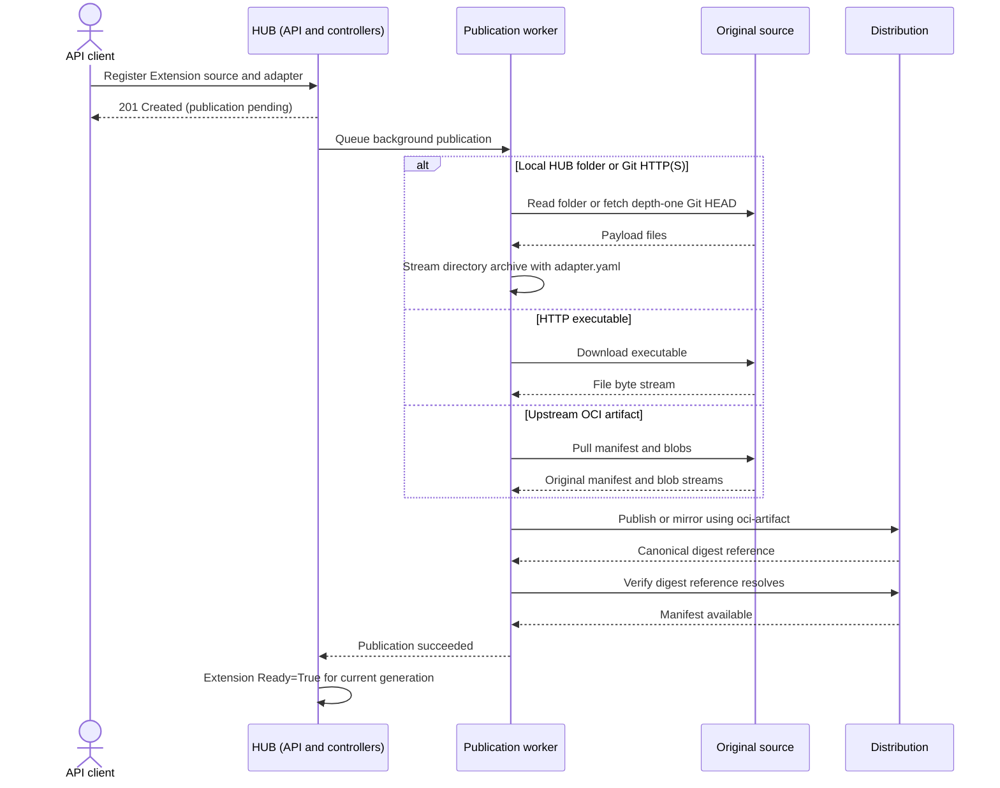

# In-Memory Asynchronous Reconciliation with Apalis

## Goal

Use Apalis 1.0 with in-memory storage to run source preparation and publication without
blocking reconciliation. When a push succeeds or fails, notify the controller's
workqueue to requeue the affected resource. On the next reconciliation, read the
outcome from an in-memory status store.

Task execution requires no database or external queue service. Distribution is
still required as the destination artifact service and may run on the same VM.
Duplicate pushes of the same content hash are acceptable.

The extension controller and background publication path are implemented. This
document records their design and the remaining integration checks.
Existing resource fields are described in the custom node plan; artifact packaging
follows the ORAS directory convention below. OCI operations use
`rust-oci-client` (the `oci-client` crate).

## Distribution contract

Every original source (local HUB folder, HTTP, Git, or upstream OCI) is published
into the configured Distribution registry. Local/Git sources become directory
artifacts, HTTP becomes one executable file layer, and upstream OCI is copied
without layout validation. Publication does not guarantee that an upstream
artifact can be materialized or used as an extension on the host. That registry
is always the source for custom node installation. The extension controller owns source preparation and publication.
Source resolution, any required packaging, and transfer run in its background task.
Upstream OCI artifacts are republished directly without unpacking.
The reconciler records the published artifact reference and manifest digest.

The [custom node plan](custom-node-type-plan.md#registry-distribution-and-local-installation)
defines the complete source-to-registry-to-local-folder lifecycle. Publication
success means the artifact is available for distribution, not that host installation
or node execution has succeeded.

## Registration and publication sequence

The API persists desired extension state before the background worker prepares and
publishes its source. The controller reports publication readiness only after the
canonical digest reference resolves in Distribution.



Host download, installation, and supervised execution follow the
[custom-node sequence](custom-node-type-plan.md#registration-preparation-and-execution-sequence).

## Source preparation and streaming publication

Git, HTTP, and upstream OCI source preparation belong to this plan. Custom node
execution consumes the resulting published artifact reference.

- **HTTP:** Use a pooled HTTP client to pull the configured URL and feed the
  response directly into a single named executable file layer as bytes arrive. The adapter
  remains in the Extension specification; HTTP payloads are not repackaged. Keep only
  bounded transient buffers in memory. MUST NOT download the complete payload to
  disk or accumulate it in memory before starting publication.
- **Git:** Use `gix` with its reqwest/rustls transport for HTTP and HTTPS.
  SSH is deferred. Fetch only the default branch's latest commit at depth one,
  without tags or ancestor history, into a private temporary bare repository.
  Pin that fetched commit and package its tree directly from Git objects without
  creating a working checkout or including repository metadata. Include the
  Extension specification as `adapter.yaml`. Stream the archive into registry
  publication through a bounded buffer. Remove the temporary object database
  after packaging, failure, or cancellation. Git object decoding may retain one
  decompressed file at a time; no complete snapshot is accumulated in memory.
- **Upstream OCI:** Resolve the configured reference to a manifest digest, then
  use the OCI client to pull blobs and push them into Distribution concurrently.
  Each blob MUST be uploaded while it is being downloaded, with bounded memory
  buffers and backpressure. Preserve descriptors, media types, annotations, and
  manifest bytes; MUST NOT materialize a local folder or repackage the payload.
  Republish upstream content as-is. Do not validate extension layout or adapter
  contents during republication; the consuming host handles installation errors.

Local HUB folders and Git snapshots use the directory packaging path with
`adapter.yaml` in the extension directory. HTTP responses remain a single executable file. Record executable intent in the
layer annotations and restore Unix permissions as `0755` on the host. Packaging and OCI upload MUST support incremental input; extend the
library path where needed rather than introducing full-payload staging.

The worker MUST finalize each blob only after its complete transfer succeeds and
publish the manifest only after all referenced blobs are available. Digest and
size metadata computed during packaging become available at stream completion;
upload MUST NOT require a prior full read to compute them. Registry transport and
digest verification remain library-owned. Mark success only after verifying the
published digest reference, as required below.

Bound concurrent transfers and buffer sizes. Cancellation or failure MUST stop
both download and upload and release pooled clients and buffers. Retries MUST
reopen the source and restart incomplete transfers under the existing attempt
policy. If a pinned Git commit or OCI digest is unavailable, fail the attempt
rather than silently substituting newer content. After process restart, resolve
sources again from desired state; transient payload buffers are not retained.

## OCI client integration

Use [rust-oci-client](https://github.com/oras-project/rust-oci-client) (`oci-client`)
for registry push and pull operations. Digest verification belongs to the library;
application code MUST NOT implement a separate digest-verification workflow. Pass
the published digest reference to the client and handle its success or error.

The application owns extension packaging, expected artifact structure, and
materialization into a local folder. This includes safe extraction and resolving
adapter entry points and working directories against the installed files. These
are separate from the library's registry transport and digest handling.

ORAS's Go `content/file` store already supports directory round trips: it archives
and compresses a directory, records its name with
`org.opencontainers.image.title`, and marks the blob for extraction with ORAS
unpack annotations. Pulling into that store restores the directory. This is a
client-side convention, not directory storage implemented by Distribution.
`rust-oci-client` provides registry transport, manifests, and blob APIs, but no
equivalent directory file store that automatically packages and restores folders.
It is sufficient for transport; using it requires a packaging/materialization
layer. Use the ORAS Go v2 / CLI directory convention: a gzip-compressed tar layer
with `org.opencontainers.image.title` naming the directory,
`io.deis.oras.content.unpack: "true"`, and `io.deis.oras.content.digest` holding
the uncompressed tar digest. Registry blob verification remains library-owned;
the Rust filesystem layer MUST implement the corresponding ORAS extraction
semantics. For local and Git sources, package one extension directory containing
`adapter.yaml` and its payload. HTTP remains a single executable file with its
adapter supplied by host dispatch. Upstream OCI is streamed unchanged without
extension-layout validation. The current copy path handles image/artifact
manifests and their config/layers; it does not recursively copy image indexes or
referrer graphs. Diamant materializes the supported file/directory layout and
uses the layer title to identify its root. Preserve executable permissions and
verify push/pull interoperability with the ORAS CLI.
This defines the initial artifact layout; no separate archive format is required.

See the [ORAS file-store API](https://pkg.go.dev/oras.land/oras-go/v2/content/file),
[directory representation](https://github.com/oras-project/oras-go/blob/main/docs/Targets.md#file-store),
and [Rust client API](https://docs.rs/oci-client/latest/oci_client/client/struct.Client.html).

## Architecture

```text
Reconciler
    |
    +-- enqueue(push) --> Executor --> Apalis MemoryStorage
    |                                            |
    |                                        Image-push worker
    |                                            |
    |                                      Save terminal result
    |                                            |
    |                                      Notify(resource_id)
    |                                            |
    +<------------------------------- Controller reconcile queue
    |
    +-- status(task_id) --> In-memory status registry
```

The notification is a **wake-up signal**, not the source of truth for the result.
The reconciler obtains state through `status()`.

## Reconciler-facing contract

Startup validates configuration and constructs the HTTP and OCI clients once,
before spawning controllers. Initialization failures are returned to the caller.
Declared and resolved adapters share typed execution (`runtime`, `command`,
optional `workingDirectory`) and binding contracts; only
plugin settings/default values retain user-defined JSON shapes. Source preparation
has separate HTTP, local-directory, and Git functions. OCI
republication follows its direct copy path. One `PreparedUpload` owns the payload
stream, optional archive producer, computed annotations, and cancellation cleanup.
The publisher accepts one layer and joins archive production before publishing
the manifest. Kubernetes status fields are derived from explicit `Preparing`,
`Published`, and `Failed` outcomes.

```rust
#[derive(Clone, Debug, Hash, Eq, PartialEq)]
pub struct ExecutionId {
    desired: String,
    attempt: u32,
}

#[derive(Clone, Debug)]
pub enum TaskStatus {
    Queued,
    Running,
    Succeeded { reference: String },
    Failed { error: String },
}
```

The controller does not depend on Apalis types. `enqueue()` returns after accepting
work, not after executing it. `status()` is a short in-memory lookup; it MUST NOT
perform registry requests or wait for execution. `None` indicates an unknown or
discarded task. The controller holds the concrete `Executor`; no executor trait
or async-trait adapter is needed. `PublishExtension` contains reconstructible source
inputs. `ExecutionId` owns desired-input hashing, persisted encoding, retry
numbers, and immutable destination tags.

Task identity MUST distinguish resource UID, desired preparation specification
hash, destination, and controller-selected attempt. Repeated submissions of the same attempt SHOULD
return the existing task ID without replacing its status. A controller retry after
terminal failure MUST select a new attempt so it does not repeatedly observe the
same retained failure. A recreated resource MUST NOT inherit an old resource's work.

## Internal components

- **Apalis `MemoryStorage`:** dispatches queued push jobs to background workers.
- **Status registry:** `Arc<RwLock<HashMap<ExecutionId, TaskRecord>>>`, using an asynchronous
  lock. Each record contains the resource ID, execution identity, and task status.
- **Completion observer:** records `Succeeded` or `Failed`, then notifies the workqueue.
- **Notifier:** a small adapter that enqueues a resource key in the existing scheduler.

Completion uses an in-process channel of resource references connected to the
Kubernetes controller's `reconcile_on` stream. The worker MUST store its terminal
result before sending that notification. No notifier trait is required.

Pin compatible Apalis 1.0 versions and verify worker completion and retry behavior
against their public APIs during implementation. Strict ordering relative to final
job acknowledgment is not required initially; storing the outcome before notifying
is required.

## Execution flow

1. Reconciler calls `enqueue(PublishExtension)` and stores the returned `ExecutionId` with its
   resource state.
2. Executor records `Queued`, then submits the job to Apalis.
3. Worker marks the task `Running` and performs the push independently.
4. Completion integration saves the terminal outcome in the registry.
5. **Only after saving the outcome**, it calls `notify(resource_id)`.
6. The controller queues another reconciliation for that resource.
7. Reconciler calls `status(task_id)` and updates resource state accordingly.

If queue submission fails, the executor MUST remove or finalize its provisional
record and return an error. It MUST NOT leave a permanently `Queued` task with no
job. Coordinate concurrent submissions without holding the registry lock across
queue submission or publication.

Disable automatic job retries initially, so a failure represents a terminal
attempt. Let the controller determine if and when to resubmit. If Apalis retries
are enabled later, notify only after terminal success/failure. Duplicate completion
callbacks MUST NOT regress terminal state. Worker panics or cancellation while the
process stays alive MUST produce a failure notification or trigger supervised
recovery; they MUST NOT leave an unobservable, permanently `Running` task.

## Reconciliation pseudocode

```rust
async fn reconcile(&self, resource: &Resource) -> Result<()> {
    if self.execution_is_obsolete(resource) {
        self.reset_execution(resource).await?;
        self.schedule_reconcile(resource);
        return Ok(());
    }

    let task_id = match &resource.task_id {
        Some(id) => id.clone(),
        None => {
            let id = self.executor.enqueue(PublishExtension::from(resource)).await?;
            self.save_task_id(resource, id).await?;
            return Ok(());
        }
    };

    match self.executor.status(&task_id).await? {
        Some(TaskStatus::Queued | TaskStatus::Running) => {}
        Some(TaskStatus::Succeeded { reference }) => {
            self.mark_ready(resource, reference).await?;
        }
        Some(TaskStatus::Failed { error }) => {
            self.mark_failed(resource, error).await?;
            self.schedule_retry_if_allowed(resource).await?;
        }
        None => {
            self.reset_execution(resource).await?;
            self.schedule_reconcile(resource);
        }
    }

    Ok(())
}
```

Helpers are illustrative. Resetting execution MUST schedule another pass, rather
than depend on a status-only update triggering the controller. An allowed retry
uses controller backoff and a new attempt identity. Resource status writes MUST
check that the observed UID and desired execution still match before marking ready.

Before recording task success, the publication worker verifies the artifact through `rust-oci-client`
using its digest reference. Push is idempotent: if reconciliation is interrupted
before verification completes, it can repeat the push as if it had never happened.
Digest verification remains library-owned.

**Race to handle:** a job may complete between `enqueue()` and persisting its task
ID. Derive the task ID from stable execution inputs and retain/coalesce notifications
arriving during reconciliation. Stable IDs alone do not guarantee a subsequent
reconcile: the scheduler MUST retain a pending pass for an already-running key.
If saving the task ID fails, controller error recovery MUST retry reconciliation;
resubmission of the same attempt can recover the existing result.

## Concurrency and lifecycle

- Reconciliation MUST NOT await an artifact publication or hold a lock across it.
- Scheduling MUST coalesce repeated notifications and serialize reconciliation of
  the same key while allowing independent resource keys to run concurrently.
- Notifications MUST NOT be silently dropped under channel backpressure. Retain
  pending keys or use an equivalent reliable in-process queue adapter.
- Configure Apalis concurrency separately from controller concurrency. Bound pushes
  and registry request timeouts to protect CPU, memory, network, and registry capacity.
- All task state is lost on process exit. At startup, reconcile managed resources
  again and resubmit missing tasks. Artifact inputs MUST be reconstructible from
  managed desired state or another retained source for restart recovery.
- Keep artifact inputs available until execution completes. Ignore results from
  obsolete desired content or destinations. Use immutable push references so stale
  workers cannot replace the current artifact under a shared mutable tag.
- Keep terminal results until the controller has observed them. Define cleanup from
  managed resource state or conservative retention without adding executor methods.
- Initially run one controller/executor process. Coordination between multiple
  replicas with independent in-memory registries is outside this design.

## Distribution as the push destination


Use CNCF Distribution 3 as a minimal OCI registry. It runs as a Docker container or
standalone `registry` binary and supports filesystem storage without a database.
It is independent of the in-memory task executor and of the Kubernetes cluster.

The registry is a separate artifact service. The requirement for no external
infrastructure applies to task execution; pushing artifacts still requires a
reachable registry. Distribution may run on the same VM as the application.

### Access through Traefik

Distribution MUST be exposed through Traefik so Diamant can reach the registry
from assigned hosts. HUB supplies an artifact reference using this externally
reachable registry authority. Diamant uses `rust-oci-client` to download the
artifact through Traefik, then materializes its files locally to bootstrap the
extension. It does not download extension payloads through the control API or
WebSocket proxy.

```text
Diamant -> Traefik -> Distribution
        <- OCI artifact contents <-
Diamant -> local extension folder -> extension bootstrap
```

Traefik routes the registry's OCI HTTP API to Distribution's internal port 5000.
Use a dedicated registry hostname, for example `registry.example.com`, with HTTPS
and configured authentication. Keep Distribution's backend port private. In Docker,
Traefik and Distribution share a network; in standalone deployments, Traefik forwards
to the registry's private or loopback listener. The local examples below show the
backend service and a direct smoke check; external clients use the Traefik endpoint.

### Shared configuration

Save as `registry-config.yml`:

```yaml
version: 0.1
storage:
  filesystem:
    rootdirectory: /var/lib/registry
http:
  addr: :5000
```

### Docker deployment

```bash
docker run -d --name suntitle-registry --restart unless-stopped \
  -p 127.0.0.1:5000:5000 \
  -v suntitle-registry-data:/var/lib/registry \
  -v "$PWD/registry-config.yml:/etc/distribution/config.yml:ro" \
  registry:3 /etc/distribution/config.yml
```

Pin a tested patch version or image digest for a deployed environment. The named
volume MUST persist across container replacement.

### Standalone deployment

Download the matching platform binary from Distribution's official releases.
Install it as `/usr/local/bin/registry`, install the configuration as
`/etc/distribution/config.yml`, and create a persistent `/var/lib/registry`
directory writable by a dedicated service user.

```bash
/usr/local/bin/registry serve /etc/distribution/config.yml
```

Run this command under systemd or an equivalent service manager with automatic
restart. For a local-only standalone endpoint, set `http.addr` to
`127.0.0.1:5000`. No Docker daemon is needed for this deployment.

For external access, expose Distribution through Traefik as described above.
Configure authentication and HTTPS at the appropriate service boundary. Back up
the data directory. A single VM provides no high-availability guarantee.

### Push request and result

The application-owned `PublishExtension` request MUST identify:

- The resource key and UID.
- The desired preparation specification hash and reconstructible source input.
- A resolved Git commit or upstream OCI manifest digest once known, retained for
  the running attempt; payload bytes remain transient streaming buffers.
- The destination registry authority and repository.
- An immutable attempt-specific tag until the content digest is known, or a
  content-derived tag if it is already known.
- A credential reference and TLS policy, without embedding secrets in task IDs.

For example, publish to
`registry.example.com/suntitle/extensions/example:attempt-<execution-id>`.
The preparation specification hash identifies desired configuration before source
transfer. It is distinct from the source content hash and OCI manifest digest.
Resolved source identities and the final manifest digest describe actual content. Return
`Succeeded { reference }` only after the registry accepts the complete manifest and
referenced blobs. Store the canonical pull reference
`registry.example.com/suntitle/extensions/example@sha256:<manifest-hash>` on the
resource. Consumers SHOULD pull by digest.

Push through `rust-oci-client`; the reconciler MUST NOT depend on the
Distribution process API or shell out to Docker. Use explicit credentials and
certificate trust settings. Permit
plain HTTP only through an explicit local-development option.

Registry timeouts and temporary unavailability are retryable within a bounded
policy. Invalid artifacts and denied access require actionable error messages.
Never place credentials in resource status, result messages, or logs.

### Manual OCI artifact smoke check

With ORAS installed and the local Docker registry running, push an existing
`extension.tar.gz` as a generic OCI artifact:

```bash
oras push --plain-http localhost:5000/suntitle/extensions/example:dev \
  --artifact-type application/vnd.suntitle.extension.v1 \
  extension.tar.gz:application/gzip

oras pull --plain-http localhost:5000/suntitle/extensions/example:dev \
  --output ./pulled-extension
```

The example artifact type is illustrative; production directory publication
currently uses the ORAS unknown-artifact convention. This command validates
generic artifact storage, not an executable extension round trip; runnable container images require
their own OCI image manifest and layers. Production pushes use HTTPS, configured
credentials, and immutable references.

From another container or a Kubernetes worker, `localhost` refers to that machine
or container. Configure a registry DNS name reachable by every actual push and
pull client. The registry does not need to run inside Kubernetes.

## Implementation checklist

- [x] Define `ExecutionId`, `TaskStatus`, `Executor`, and channel-based reconcile notifications.
- [x] Configure Apalis `MemoryStorage` and an publication worker with retries disabled.
- [x] Add an in-memory registry keyed by execution identity and associated with resource IDs.
- [x] Implement `enqueue()` and `status()`, including submission failure cleanup.
- [x] Record job start and terminal outcomes, including worker interruption handling.
- [x] Wire completion/failure to the controller queue after storing terminal status.
- [x] Handle early notifications, duplicate submissions/events, and unknown task IDs.
- [x] Define controller retry backoff, attempt identities, and result retention.
- [x] Prepare local HUB folders using the agreed extension artifact structure.
- [x] Add Git HTTP(S) preparation with gix: default HEAD, depth-one bare temporary repository, no tags or checkout, and streamed archive publication.
- [x] Add HTTP source preparation: pooled client and bounded streaming into one executable file layer.
- [x] Add upstream OCI source preparation: concurrent blob pull/push into Distribution, preserving the artifact unchanged without layout validation.
- [x] Support incremental archive packaging and uploads without staging complete archives; Git uses the agreed temporary bare object database.
- [x] Integrate Distribution pushes and record the canonical digest reference.
- [x] Dispatch an existing current artifact reference to Diamant for library-managed pull and local materialization.
- [x] Expose Compose Distribution through Traefik and verify library/ORAS push-pull interoperability.
- [x] Configure HUB publication to produce artifact references reachable by assigned hosts.
- [x] Verify Diamant download/report with a simulated registry and registration server, including heartbeats and cancellation.

The extension controller now prepares local HUB folders, HTTP executable files,
and Git HTTP(S) snapshots, and republishes upstream OCI artifacts unchanged. Apalis
runs preparation and publication in the background. Completion notifications
requeue the Extension, whose status records publication readiness and the canonical
artifact reference. Node resolution and Diamant preparation consume that reference. Host dispatch
includes the resolved adapter. Diamant retains the prepared installation and
execution paths for the node, reporting `Installed=True` before custom apply
constructs arguments and launches the runnable. Native execution and embedded-UV
Python command selection are implemented. Payload caching preserves installed
files across command changes and reconnects.

Publication and host preparation are implemented. Existing tests cover resource
resolution, executor results, Git shallow snapshots, download/preparation handoff,
heartbeats, and cancellation. The Compose/ORAS test verifies registry transport
interoperability. It does not prove extension registration through process launch.
`just custom-node-e2e` separately verifies registration through actual native,
Python script, and Python module launch for local and mirrored OCI sources. OCI
seed artifacts are pushed through `oci_artifact::Publisher` into a separate source
repository before the Extension controller mirrors them into its managed repository.

Recovery automation, complete acceptance coverage, and UI integration are tracked
in the [custom node execution plan](custom-node-type-plan.md#remaining-recovery-and-acceptance).
Do not add another publication executor, source-discovery mechanism, or artifact
layout validation stage for these follow-ups.

### Remaining delivery checks

- [x] Run API-to-running-process acceptance for native, Python script, and Python module extensions from local and OCI sources. Broader lifecycle coverage remains separate.
- [ ] Verify the static Linux builds for the server binaries and Diamant. The current musl Dockerfile checks the API/proxy for dynamic dependencies, but does not build Diamant; its host artifact needs an equivalent build/check before claiming a complete static release.

### Optional deployment and coverage follow-up

- [ ] Verify standalone Distribution deployment if that deployment mode is needed; Compose is the current integrated path.
- [ ] Extend transfer/recovery coverage when changing retry, concurrency, or registry behavior. Implemented recovery rules and isolated tests are not evidence that every recovery scenario has been exercised end to end.

## Acceptance criteria

| Situation | Expected behavior |
|---|---|
| Push enqueued | Reconciler returns without waiting for execution |
| Queue submission fails | Error returned; no orphaned queued record |
| Push running | Other resources continue reconciling |
| Push succeeds | Result stored, resource requeued, status observable |
| Push fails | Error stored, resource requeued, status observable |
| Worker interrupted | Failure or supervised recovery prevents a stuck task |
| Controller retries | New attempt runs after controller backoff |
| Duplicate notification | Reconcile remains idempotent |
| Early notification | Another pass remains queued after saving the task ID |
| Desired state changes | Obsolete result cannot mark the current resource ready |
| Process restart | Lost tasks detected; reconstructible work may be resubmitted |
| Many pushes | Execution concurrency remains bounded |
| Artifact published | Pull by reported manifest digest succeeds |
| Any original source | Nodes pull the published payload from Distribution; publication alone does not prove host compatibility |
| HTTP source | Registry upload overlaps the HTTP response; the payload is not staged |
| Local/Git directory packaging | Archive production overlaps upload; no complete archive is staged |
| Git source | Default HEAD is fetched at depth one into a temporary bare repository before packaging; no checkout, tags, or ancestor history |
| Upstream OCI source | Each supported manifest blob streams from pull into push; manifest bytes/digest are preserved without layout validation |
| Transfer failure or cancellation | Both sides stop; incomplete work cannot mark the extension ready |
| Host installation | Supported payload materializes as a file/directory; adapter execution paths are prepared before launch |

Normal execution requires no periodic task-status polling, database, or external
queue service. Distribution remains the artifact destination.

## Design boundary

The reconciler only calls **`enqueue()`** and **`status()`** on the executor. Apalis
owns background execution; the in-memory registry owns queryable outcomes; the
completion observer notifies the existing reconcile scheduler. SQLite persistence
and distributed execution are outside the initial implementation.

## References


- [Apalis 1.0](https://docs.rs/crate/apalis/1.0.0)
- [Apalis middleware](https://apalis.dev/docs/guides/workers/middleware)
- [Distribution configuration](https://distribution.github.io/distribution/about/configuration/)
- [Distribution releases](https://github.com/distribution/distribution/releases)
- [ORAS push and pull](https://oras.land/docs/how_to_guides/pushing_and_pulling/)
- [ORAS pull options](https://oras.land/docs/commands/oras_pull/)

- [rust-oci-client](https://github.com/oras-project/rust-oci-client)
