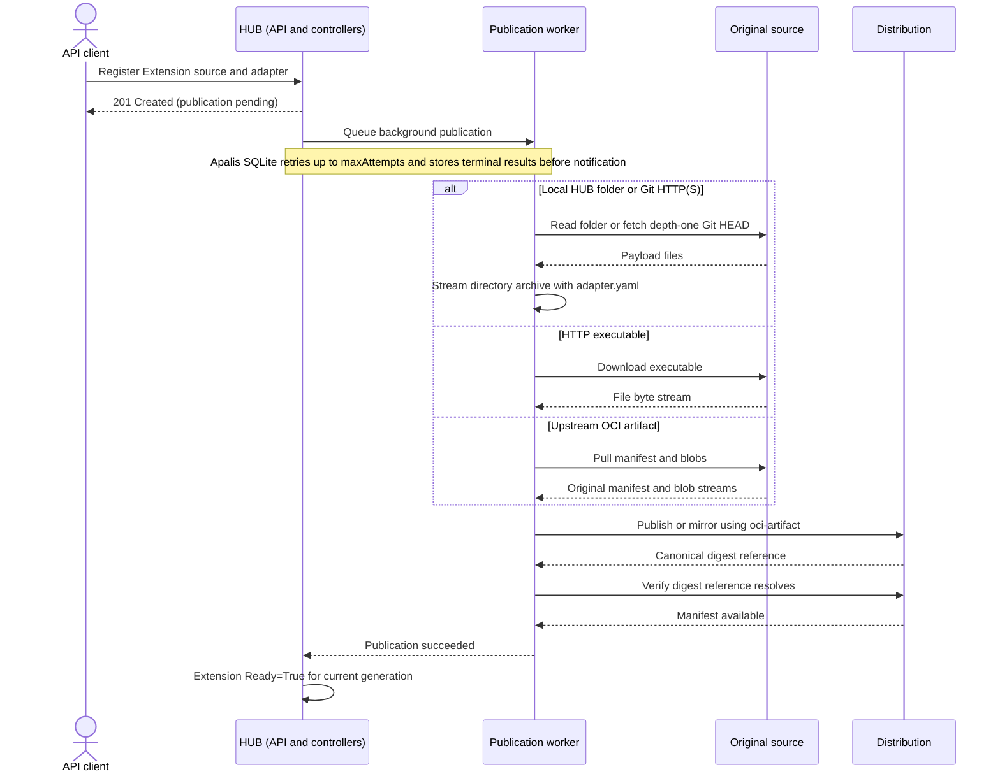

# Asynchronous Reconciliation with Apalis SQLite

## Goal

Use Apalis 1.0 with an in-memory SQLite backend to run source preparation and publication without
blocking reconciliation. When a push succeeds or fails, notify the controller's
workqueue to requeue the affected resource. On the next reconciliation, read the
outcome from the in-memory SQLite database.

Task execution requires no external database or queue service. Distribution is
still required as the destination artifact service and may run on the same VM.
Duplicate pushes of the same content hash are acceptable.

The extension controller and background publication path are implemented. This
document records their design and the remaining integration checks.
Existing resource fields are described in the custom node plan; artifact packaging
follows the ORAS directory convention below. OCI operations use
`rust-oci-client` (the `oci-client` crate).

## Distribution contract

Every original source (local HUB folder, HTTP, Git, or upstream OCI) is published
into the configured Distribution registry. Local/Git sources become directory
artifacts, HTTP becomes one executable file layer, and upstream OCI is copied
without layout validation. Publication does not guarantee that an upstream
artifact can be materialized or used as an extension on the host. That registry
is always the source for custom node installation. The extension controller owns source preparation and publication.
Source resolution, any required packaging, and transfer run in its background task.
Upstream OCI artifacts are republished directly without unpacking.
The reconciler records the published artifact reference and manifest digest.

The [custom node plan](custom-node-type-plan.md#registry-distribution-and-local-installation)
defines the complete source-to-registry-to-local-folder lifecycle. Publication
success means the artifact is available for distribution, not that host installation
or node execution has succeeded.

## Registration and publication sequence

The API persists desired extension state before the background worker prepares and
publishes its source. The controller reports publication readiness only after the
canonical digest reference resolves in Distribution.



Host download, installation, and supervised execution follow the
[custom-node sequence](custom-node-type-plan.md#registration-preparation-and-execution-sequence).

## Source preparation and streaming publication

Git, HTTP, and upstream OCI source preparation belong to this plan. Custom node
execution consumes the resulting published artifact reference.

- **HTTP:** Use a pooled HTTP client to pull the configured URL and feed the
  response directly into a single named executable file layer as bytes arrive. The adapter
  remains in the Extension specification; HTTP payloads are not repackaged. Keep only
  bounded transient buffers in memory. MUST NOT download the complete payload to
  disk or accumulate it in memory before starting publication.
- **Git:** Use `gix` with its reqwest/rustls transport for HTTP and HTTPS.
  SSH is deferred. Fetch only the default branch's latest commit at depth one,
  without tags or ancestor history, into a private temporary bare repository.
  Pin that fetched commit and package its tree directly from Git objects without
  creating a working checkout or including repository metadata. Include the
  Extension specification as `adapter.yaml`. Stream the archive into registry
  publication through a bounded buffer. Remove the temporary object database
  after packaging, failure, or cancellation. Git object decoding may retain one
  decompressed file at a time; no complete snapshot is accumulated in memory.
- **Upstream OCI:** Resolve the configured reference to a manifest digest, then
  use the OCI client to pull blobs and push them into Distribution concurrently.
  Each blob MUST be uploaded while it is being downloaded, with bounded memory
  buffers and backpressure. Preserve descriptors, media types, annotations, and
  manifest bytes; MUST NOT materialize a local folder or repackage the payload.
  Republish upstream content as-is. Do not validate extension layout or adapter
  contents during republication; the consuming host handles installation errors.

Local HUB folders and Git snapshots use the directory packaging path with
`adapter.yaml` in the extension directory. HTTP responses remain a single executable file. Record executable intent in the
layer annotations and restore Unix permissions as `0755` on the host. Packaging and OCI upload MUST support incremental input; extend the
library path where needed rather than introducing full-payload staging.

The worker MUST finalize each blob only after its complete transfer succeeds and
publish the manifest only after all referenced blobs are available. Digest and
size metadata computed during packaging become available at stream completion;
upload MUST NOT require a prior full read to compute them. Registry transport and
digest verification remain library-owned. Mark success only after verifying the
published digest reference, as required below.

Bound concurrent transfers and buffer sizes. Cancellation or failure MUST stop
both download and upload and release pooled clients and buffers. Retries MUST
reopen the source and restart incomplete transfers under the existing attempt
policy. If a pinned Git commit or OCI digest is unavailable, fail the attempt
rather than silently substituting newer content. After process restart, resolve
sources again from desired state; transient payload buffers are not retained.

## OCI client integration

Use [rust-oci-client](https://github.com/oras-project/rust-oci-client) (`oci-client`)
for registry push and pull operations. Digest verification belongs to the library;
application code MUST NOT implement a separate digest-verification workflow. Pass
the published digest reference to the client and handle its success or error.

The application owns extension packaging, expected artifact structure, and
materialization into a local folder. This includes safe extraction and resolving
adapter entry points and working directories against the installed files. These
are separate from the library's registry transport and digest handling.

ORAS's Go `content/file` store already supports directory round trips: it archives
and compresses a directory, records its name with
`org.opencontainers.image.title`, and marks the blob for extraction with ORAS
unpack annotations. Pulling into that store restores the directory. This is a
client-side convention, not directory storage implemented by Distribution.
`rust-oci-client` provides registry transport, manifests, and blob APIs, but no
equivalent directory file store that automatically packages and restores folders.
It is sufficient for transport; using it requires a packaging/materialization
layer. Use the ORAS Go v2 / CLI directory convention: a gzip-compressed tar layer
with `org.opencontainers.image.title` naming the directory,
`io.deis.oras.content.unpack: "true"`, and `io.deis.oras.content.digest` holding
the uncompressed tar digest. Registry blob verification remains library-owned;
the Rust filesystem layer MUST implement the corresponding ORAS extraction
semantics. For local and Git sources, package one extension directory containing
`adapter.yaml` and its payload. HTTP remains a single executable file with its
adapter supplied by host dispatch. Upstream OCI is streamed unchanged without
extension-layout validation. The current copy path handles image/artifact
manifests and their config/layers; it does not recursively copy image indexes or
referrer graphs. Diamant materializes the supported file/directory layout and
uses the layer title to identify its root. Preserve executable permissions and
verify push/pull interoperability with the ORAS CLI.
This defines the initial artifact layout; no separate archive format is required.

See the [ORAS file-store API](https://pkg.go.dev/oras.land/oras-go/v2/content/file),
[directory representation](https://github.com/oras-project/oras-go/blob/main/docs/Targets.md#file-store),
and [Rust client API](https://docs.rs/oci-client/latest/oci_client/client/struct.Client.html).

## Architecture

Reconciliation uses `SqliteStorage<PublishExtension>` directly. There is no executor
wrapper, custom task-status enum, or parallel result registry. SQLite owns admission,
deduplication, pending/running state, and completed results. The database is in memory;
no database server or database file is required.

Startup validates configuration, creates source clients, and migrates SQLite before
spawning controllers. Initialization errors are returned to the caller. One pooled
connection serializes short database operations; source preparation and publication
run outside database transactions and independently of reconciliation.

## Reconciler-facing contract

A deterministic Apalis `TaskId` hashes resource UID, desired source and adapter,
resource generation, and destination settings. SQLite requires its ULID representation.
The same ID is the idempotency key and remains unchanged across Apalis retries.
Repeated `push_task()` calls are atomic no-ops for an existing task, including a
terminal task. There is no custom execution identity or controller attempt suffix.

`spec.maxAttempts` defaults to three total executions and is passed directly to
Apalis `TaskBuilder::max_attempts()`. SQLite owns retry admission and attempt counting.
`status.attempts` copies the final Apalis count; it does not drive retry scheduling.
The Ready condition distinguishes Preparing (including retries), ArtifactPublished,
and terminal PreparationFailed. No retry map, deadline field, or retry timer is needed.

The controller calls native `check_status()` to read a stored terminal
`TaskResult<String>`. No result means preparation is pending or running. Native
`fetch_by_id()` also exposes individual Pending/Running states when needed.
Neither operation performs source or registry I/O. Kubernetes status is derived from
the native `Option<TaskResult<String>>`: no result is Preparing, success is ArtifactPublished,
and failure is PreparationFailed.

## Execution and notification

1. Reconciliation submits an immutable command using `push_task()` with a stable
   task ID, idempotency key, and `max_attempts(spec.max_attempts)`.
2. It reads any stored result and updates resource status with UID/resource-version
   preconditions. Pending work awaits its stored-result completion notification.
3. Apalis schedules publication within its configured concurrency and records task
   transitions and the handler's success or failure. `Sources` is injected through
   Apalis `Data<Sources>`. `CatchPanicLayer` converts panics to ordinary I/O errors
   so they retain the same storage-managed retry behavior.
4. An independent completion observer uses native `wait_for_single()` to wait for
   result storage before sending the resource key to `reconcile_on`. Its polling
   occurs outside reconciliation and does not hold an execution slot. Observation
   errors retry the subscription after one second without consuming publication attempts.
5. SQLite retries failed executions up to the configured attempt limit. The observer
   waits across retries and notifies only after success or exhausted attempts.
6. Reconciliation copies the final result and attempt count into resource status.
   It returns `await_change()` for both pending and terminal tasks.

A notification is a wake-up signal; SQLite remains authoritative. The controller
scheduler coalesces repeated notifications, including one received during an active
reconcile. Pending work does not schedule polling or an immediate follow-up after
submission. A repeated submission recovers
results even if the previous task-ID status write failed.

```rust
storage.push_task(command_for(resource, &id)).await?;
let state = storage.check_status([id]).await?.pop();
write_status(resource, &id, &state).await?;
await_change()
```

## Concurrency and lifecycle

- Reconciliation MUST NOT await publication or hold a lock across it. Database
  operations only admit tasks and inspect already stored state.
- Apalis concurrency is independent of controller concurrency. Transfer timeouts
  bound source preparation and registry operations.
- Completion observation runs concurrently with the worker so result persistence
  can progress. Notifications MUST follow a stored terminal result.
- Shutdown cancels transfers, stops Apalis, and joins its active handlers and storage
  cleanup. Pending commands need not execute during shutdown.
- Commands and results remain in SQLite for the process lifetime. The former custom
  capacity limit, observation timestamps, and retention sweep are removed. Cleanup
  for long-lived processes is a separate follow-up.
- After process restart, Kubernetes desired state reconstructs missing work. Keep
  artifact inputs available for that recovery. An artifact reference for the current
  observed generation skips submission, including after restart. A changed generation
  republishes the source. Other submissions rely on SQLite deduplication; an empty
  database accepts unfinished or exhausted work with a fresh attempt budget.
  Results for obsolete desired state
  MUST NOT mark the current resource ready; destination tags are stable for one desired revision.
- One controller process owns this in-memory database. Persistent databases and
  coordination between multiple controller replicas remain separate work.

## Distribution as the push destination


Use CNCF Distribution 3 as a minimal OCI registry. It runs as a Docker container or
standalone `registry` binary and supports filesystem storage without a database.
It is independent of the in-memory task executor and of the Kubernetes cluster.

The registry is a separate artifact service. The requirement for no external
infrastructure applies to task execution; pushing artifacts still requires a
reachable registry. Distribution may run on the same VM as the application.

### Access through Traefik

Distribution MUST be exposed through Traefik so Diamant can reach the registry
from assigned hosts. HUB supplies an artifact reference using this externally
reachable registry authority. Diamant uses `rust-oci-client` to download the
artifact through Traefik, then materializes its files locally to bootstrap the
extension. It does not download extension payloads through the control API or
WebSocket proxy.

```text
Diamant -> Traefik -> Distribution
        <- OCI artifact contents <-
Diamant -> local extension folder -> extension bootstrap
```

Traefik routes the registry's OCI HTTP API to Distribution's internal port 5000.
Use a dedicated registry hostname, for example `registry.example.com`, with HTTPS
and configured authentication. Keep Distribution's backend port private. In Docker,
Traefik and Distribution share a network; in standalone deployments, Traefik forwards
to the registry's private or loopback listener. The local examples below show the
backend service and a direct smoke check; external clients use the Traefik endpoint.

### Shared configuration

Save as `registry-config.yml`:

```yaml
version: 0.1
storage:
  filesystem:
    rootdirectory: /var/lib/registry
http:
  addr: :5000
```

### Docker deployment

```bash
docker run -d --name suntitle-registry --restart unless-stopped \
  -p 127.0.0.1:5000:5000 \
  -v suntitle-registry-data:/var/lib/registry \
  -v "$PWD/registry-config.yml:/etc/distribution/config.yml:ro" \
  registry:3 /etc/distribution/config.yml
```

Pin a tested patch version or image digest for a deployed environment. The named
volume MUST persist across container replacement.

### Standalone deployment

Download the matching platform binary from Distribution's official releases.
Install it as `/usr/local/bin/registry`, install the configuration as
`/etc/distribution/config.yml`, and create a persistent `/var/lib/registry`
directory writable by a dedicated service user.

```bash
/usr/local/bin/registry serve /etc/distribution/config.yml
```

Run this command under systemd or an equivalent service manager with automatic
restart. For a local-only standalone endpoint, set `http.addr` to
`127.0.0.1:5000`. No Docker daemon is needed for this deployment.

For external access, expose Distribution through Traefik as described above.
Configure authentication and HTTPS at the appropriate service boundary. Back up
the data directory. A single VM provides no high-availability guarantee.

### Push request and result

The application-owned `PublishExtension` request MUST identify:

- The resource key and UID.
- The desired preparation specification hash and reconstructible source input.
- A resolved Git commit or upstream OCI manifest digest once known, retained for
  the running attempt; payload bytes remain transient streaming buffers.
- The destination registry authority and repository.
- An immutable desired-revision tag until the content digest is known, or a
  content-derived tag if it is already known.
- A credential reference and TLS policy, without embedding secrets in task IDs.

For example, publish to
`registry.example.com/suntitle/extensions/example:publication-<task-id>`.
The preparation specification hash identifies desired configuration before source
transfer. It is distinct from the source content hash and OCI manifest digest.
Resolved source identities and the final manifest digest describe actual content. Return
`Ok(reference)` only after the registry accepts the complete manifest and
referenced blobs. Store the canonical pull reference
`registry.example.com/suntitle/extensions/example@sha256:<manifest-hash>` on the
resource. Consumers SHOULD pull by digest.

Push through `rust-oci-client`; the reconciler MUST NOT depend on the
Distribution process API or shell out to Docker. Use explicit credentials and
certificate trust settings. Permit
plain HTTP only through an explicit local-development option.

Registry timeouts and temporary unavailability are retryable within a bounded
policy. Invalid artifacts and denied access require actionable error messages.
Never place credentials in resource status, result messages, or logs.

### Manual OCI artifact smoke check

With ORAS installed and the local Docker registry running, push an existing
`extension.tar.gz` as a generic OCI artifact:

```bash
oras push --plain-http localhost:5000/suntitle/extensions/example:dev \
  --artifact-type application/vnd.suntitle.extension.v1 \
  extension.tar.gz:application/gzip

oras pull --plain-http localhost:5000/suntitle/extensions/example:dev \
  --output ./pulled-extension
```

The example artifact type is illustrative; production directory publication
currently uses the ORAS unknown-artifact convention. This command validates
generic artifact storage, not an executable extension round trip; runnable container images require
their own OCI image manifest and layers. Production pushes use HTTPS, configured
credentials, and immutable references.

From another container or a Kubernetes worker, `localhost` refers to that machine
or container. Configure a registry DNS name reachable by every actual push and
pull client. The registry does not need to run inside Kubernetes.

## Implementation checklist

- [x] Define stable execution identities and channel-based reconcile notifications.
- [x] Use native Apalis SQLite admission, deduplication, task state, and stored results.
- [x] Initialize an isolated in-memory database before starting controllers.
- [x] Delegate max attempts, retry admission, and attempt counts directly to Apalis SQLite.
- [x] Join active publication and native storage cleanup during shutdown.
- [x] Wire completion/failure to the controller queue after storing terminal status.
- [x] Handle early notifications, duplicate submissions/events, and unknown task IDs.
- [x] Expose spec.maxAttempts (default three), terminal status.attempts, and process-lifetime result storage.
- [x] Prepare local HUB folders using the agreed extension artifact structure.
- [x] Add Git HTTP(S) preparation with gix: default HEAD, depth-one bare temporary repository, no tags or checkout, and streamed archive publication.
- [x] Add HTTP source preparation: pooled client and bounded streaming into one executable file layer.
- [x] Add upstream OCI source preparation: concurrent blob pull/push into Distribution, preserving the artifact unchanged without layout validation.
- [x] Support incremental archive packaging and uploads without staging complete archives; Git uses the agreed temporary bare object database.
- [x] Integrate Distribution pushes and record the canonical digest reference.
- [x] Dispatch an existing current artifact reference to Diamant for library-managed pull and local materialization.
- [x] Expose Compose Distribution through Traefik and verify library/ORAS push-pull interoperability.
- [x] Configure HUB publication to produce artifact references reachable by assigned hosts.
- [x] Verify Diamant download/report with a simulated registry and registration server, including heartbeats and cancellation.

The extension controller now prepares local HUB folders, HTTP executable files,
and Git HTTP(S) snapshots, and republishes upstream OCI artifacts unchanged. Apalis
runs preparation and publication in the background. Completion notifications
requeue the Extension, whose status records publication readiness and the canonical
artifact reference. Node resolution and Diamant preparation consume that reference. Host dispatch
includes the resolved adapter. Diamant retains the prepared installation and
execution paths for the node, reporting `Installed=True` before custom apply
constructs arguments and launches the runnable. Native execution and embedded-UV
Python command selection are implemented. Payload caching preserves installed
files across command changes and reconnects.

Publication and host preparation are implemented. Existing tests cover resource
resolution, executor results, Git shallow snapshots, download/preparation handoff,
heartbeats, and cancellation. The Compose/ORAS test verifies registry transport
interoperability. It does not prove extension registration through process launch.
`just custom-node-e2e` separately verifies registration through actual native,
Python script, and Python module launch for local and mirrored OCI sources. OCI
seed artifacts are pushed through `oci_artifact::Publisher` into a separate source
repository before the Extension controller mirrors them into its managed repository.

Recovery automation, complete acceptance coverage, and UI integration are tracked
in the [custom node execution plan](custom-node-type-plan.md#remaining-recovery-and-acceptance).
Do not add another publication executor, source-discovery mechanism, or artifact
layout validation stage for these follow-ups.

### Remaining delivery checks

- [x] Run API-to-running-process acceptance for native, Python script, and Python module extensions from local and OCI sources. Broader lifecycle coverage remains separate.
- [ ] Verify the static Linux builds for the server binaries and Diamant. The current musl Dockerfile checks the API/proxy for dynamic dependencies, but does not build Diamant; its host artifact needs an equivalent build/check before claiming a complete static release.

### Optional deployment and coverage follow-up

- [ ] Verify standalone Distribution deployment if that deployment mode is needed; Compose is the current integrated path.
- [ ] Extend transfer/recovery coverage when changing retry, concurrency, or registry behavior. Implemented recovery rules and isolated tests are not evidence that every recovery scenario has been exercised end to end.

## Acceptance criteria

| Situation | Expected behavior |
|---|---|
| Push enqueued | Reconciler returns without waiting for execution |
| Queue submission fails | Error returned; no orphaned queued record |
| Push running | Other resources continue reconciling |
| Push succeeds | Result stored, resource requeued, status observable |
| Push fails | Error stored, resource requeued, status observable |
| Worker interrupted | Failure or supervised recovery prevents a stuck task |
| Publication retries | Apalis retries the same task up to spec.maxAttempts; default three total attempts |
| Duplicate notification | Reconcile remains idempotent |
| Early notification | Another pass remains queued after saving the task ID |
| Desired state changes | Obsolete result cannot mark the current resource ready |
| Process restart | Lost tasks detected; reconstructible work may be resubmitted |
| Many pushes | Execution concurrency remains bounded |
| Artifact published | Pull by reported manifest digest succeeds |
| Any original source | Nodes pull the published payload from Distribution; publication alone does not prove host compatibility |
| HTTP source | Registry upload overlaps the HTTP response; the payload is not staged |
| Local/Git directory packaging | Archive production overlaps upload; no complete archive is staged |
| Git source | Default HEAD is fetched at depth one into a temporary bare repository before packaging; no checkout, tags, or ancestor history |
| Upstream OCI source | Each supported manifest blob streams from pull into push; manifest bytes/digest are preserved without layout validation |
| Transfer failure or cancellation | Both sides stop; incomplete work cannot mark the extension ready |
| Host installation | Supported payload materializes as a file/directory; adapter execution paths are prepared before launch |

Stored terminal completion notifications wake reconciliation. Apalis owns retry
scheduling; reconciliation does not schedule publication retry timers. No external database or queue service is required;
Distribution remains the artifact destination.

## Design boundary

The reconciler uses native Apalis SQLite APIs directly. Apalis owns scheduling,
task state, idempotency, and results. A completion observer bridges stored results
to the existing reconciliation scheduler. Disk persistence, result cleanup, and
distributed execution remain follow-ups.

## References


- [Apalis 1.0](https://docs.rs/crate/apalis/1.0.0)
- [Apalis SQLite 1.0](https://docs.rs/apalis-sqlite/1.0.0/apalis_sqlite/)
- [Apalis middleware](https://apalis.dev/docs/guides/workers/middleware)
- [Distribution configuration](https://distribution.github.io/distribution/about/configuration/)
- [Distribution releases](https://github.com/distribution/distribution/releases)
- [ORAS push and pull](https://oras.land/docs/how_to_guides/pushing_and_pulling/)
- [ORAS pull options](https://oras.land/docs/commands/oras_pull/)

- [rust-oci-client](https://github.com/oras-project/rust-oci-client)
