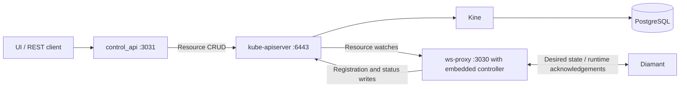

# Storage refactor: custom resources and Kubernetes watches

Status: proposed implementation plan. No implementation changes made.

## Pre-production scope

The current application logic is pre-production and can be replaced freely.
There is no backward-compatibility, identity-preservation, data-migration, or
rolling-upgrade requirement. Choose the models, identifiers, API shapes, and
WebSocket protocol that work best for the new architecture, and update all
callers together. Do not build transition adapters for legacy UUIDs, revisions,
sessions, command records, or response documents.

The current domain models are the starting point for custom resource `spec`
types, not a second persistence model to preserve alongside them. Reuse useful
typed settings and validation, and reshape fields to fit Kubernetes resources.
Runtime correctness (for example rejecting an acknowledgement for a deleted
resource) still matters in the new design; it is not a migration requirement.

## Objective

Keep the existing standalone **Kine + kube-apiserver** infrastructure, with
PostgreSQL behind Kine. Replace application storage models with ordinary
Kubernetes custom resources. The control API reads, creates, updates, and deletes
resources through kube-apiserver. The WS proxy watches those resources and
distributes the desired state to Diamant over WebSockets, then writes runtime
status back through kube-apiserver.

Neither application connects to PostgreSQL or Kine directly. No kind cluster,
worker nodes, scheduler, or Kubernetes controller-manager is required. Run an
application controller for the custom resources **inside ws-proxy**. It shares
the proxy's process lifecycle and Kubernetes client; no separate controller
service is deployed. It owns reconciliation and condition updates; the WebSocket layer
delivers its desired state and returns runtime acknowledgements.

This plan supersedes the PostgreSQL storage and eventing portions of
`ai/api-ws-proxy-separation-plan.md`.



Audio, transcription, and translation traffic continues through the existing
WebSocket relay; it is not stored in custom resources.

## Current implementation to replace

- `ws-proxy/src/storage/mod.rs`: global `Snapshot`, optimistic snapshot updates,
  `Mutation`, session records, and `PendingCommand` generation.
- `ws-proxy/src/storage/postgres.rs`: SQL persistence, migrations, PostgreSQL
  notifications, recovery scans, and the advisory lock enforcing one proxy.
- `ws-proxy/src/main.rs`: notification-triggered dispatch of pending commands and
  periodic database polling.
- `ws-proxy/src/bin/control_api.rs`: direct PostgreSQL initialization.
- Database-specific startup commands, integration fixtures, and dependencies.

The current API implements host listing and node create/read/update/restart.
Node deletion is new behavior and needs an explicit REST and WebSocket contract.
Replace public response shapes and protocol details as needed. Update OpenAPI,
UI data access, mock fixtures, and Diamant together rather than retaining a legacy
representation solely for compatibility.

## Resource model

Start with two namespaced CRDs in a dedicated `suntitle` namespace. Proposed API
group/version: `control.suntitle.io/v1alpha1`; confirm the group before publishing
the first manifests. Use distinct kinds to avoid confusion with Kubernetes Nodes.

| Resource | Desired/configuration fields | Observed fields in `/status` |
| --- | --- | --- |
| `SuntitleHost` | Host display configuration | IP, agent version, reported metadata, last heartbeat, session ID, presence |
| `SuntitleNode` | Host reference, type, name, description, enabled, typed settings, input reference, restart token | Runtime state, message, observed generation, acknowledged restart token, reporting session |

- Use Kubernetes namespace/name for addressing and server-assigned
  `metadata.uid` for the identity of a particular resource incarnation. Names can
  be readable or server-generated; no legacy UUID mapping is needed. Diamant can
  register against a configured host resource name instead of its old ID file.
- Make node type and host reference immutable initially to keep replacement and
  relocation explicit: delete/recreate a node when changing either. This is a
  simplicity choice for the new design, not an inherited compatibility rule.
- Do not persist embedded copies of hosts inside nodes. Use resource references
  and derive connection topology. Keep the node-type catalog in code.
- Every node has a `metadata.ownerReferences` entry pointing to its
  `SuntitleHost`, with `controller: true`. All nodes on one host share that host's
  name and UID in their controller owner reference. The referenced owner is the
  host resource, not the ws-proxy process or an upstream pipeline node.
- Define structural schemas, required/nullable fields, defaults, type-specific
  settings validation, and status subresources. Test the generated schemas against
  real kube-apiserver, including direct kubectl writes.
- Use `metadata.generation` to identify desired specification changes and an
  `observedGeneration` status field for runtime acknowledgement. Use
  `metadata.resourceVersion` for optimistic writes and watch cursors; application
  code treats it as an opaque token, never a command revision.
- Sessions belong to host status; socket senders and routing remain in memory.
  Do not introduce a command/outbox CRD in the initial design.

The schema and status split follow the Kubernetes
[custom resource definition model](https://kubernetes.io/docs/tasks/extend-kubernetes/custom-resources/custom-resource-definitions/).

### Mapping current models into resources

Refactor `NodeUpdate`/`NodeSettings` into `SuntitleNodeSpec` with externally tagged
`settings`: one variant key selects the immutable node type and contains its configuration. Refactor the configurable part of `Host`
into `SuntitleHostSpec`. A complete resource consists of Kubernetes metadata,
that domain specification, and separately observed status.

| Current field/model | Proposed location or replacement |
| --- | --- |
| `NodeUpdate.name`, `description`, `enabled` | Corresponding fields in node `spec` |
| `NodeUpdate.type`, `settings` | `spec.settings.<type>` containing the typed settings |
| `NodeInputUpdate.inputNodeId` | `spec.inputRef.name`, referencing a node in the same namespace |
| `NodeBase.host` | `spec.hostRef.name` plus a controller owner reference to that host's UID in `metadata.ownerReferences` |
| `Host.name` | Host `spec.name`, a display name independent of `metadata.name` |
| `Host.ip`, `version`, `metadata`, `lastSeenAt`, `status` | Host `status` fields; rename reported `metadata` to `reportedMetadata` |
| Node/host `id` | Kubernetes `metadata.name` for addressing and `metadata.uid` for incarnation identity |
| Node `status` and connection observations | Node `status`; derive topology from input references, store only necessary runtime observations |
| `createdAt` | Kubernetes `metadata.creationTimestamp` |
| `updatedAt` | Controller-managed `status.conditions`: use the `Updated` condition's `lastTransitionTime` for the update transition timestamp |
| `DesiredNode`, `PendingCommand`, global snapshot version | Remove; desired state is `spec`, progress is `status`, concurrency is resource metadata |

### Example host and node specifications

These are proposed create/apply documents, not deployed CRDs. The API server adds
UID, generation, resource version, and creation timestamp. The application adds
its cleanup finalizer when creating a node; bootstrap fixtures must do the same
before allowing runtime dispatch. Create the host first, then read its actual
`metadata.uid` to populate both node owner references. The example UID below is
a placeholder; it must be replaced with that server-assigned value.

```yaml
apiVersion: control.suntitle.io/v1alpha1
kind: SuntitleHost
metadata:
  name: studio-host
  namespace: suntitle
spec:
  name: Studio workstation
---
apiVersion: control.suntitle.io/v1alpha1
kind: SuntitleNode
metadata:
  name: studio-microphone
  namespace: suntitle
  ownerReferences:
    - apiVersion: control.suntitle.io/v1alpha1
      kind: SuntitleHost
      name: studio-host
      uid: HOST_UID_FROM_API_SERVER
      controller: true
      blockOwnerDeletion: true
  finalizers:
    - control.suntitle.io/runtime-cleanup
spec:
  name: Studio microphone
  description: Default local audio input
  hostRef:
    name: studio-host
  enabled: true
  inputRef: null
  settings:
    audio_source:
      sampleRateHz: 16000
      channels: 1
      encoding: pcm_s16le
      deviceName: null
---
apiVersion: control.suntitle.io/v1alpha1
kind: SuntitleNode
metadata:
  name: studio-transcriber
  namespace: suntitle
  ownerReferences:
    - apiVersion: control.suntitle.io/v1alpha1
      kind: SuntitleHost
      name: studio-host
      uid: HOST_UID_FROM_API_SERVER
      controller: true
      blockOwnerDeletion: true
  finalizers:
    - control.suntitle.io/runtime-cleanup
spec:
  name: Studio transcription
  description: Transcribe microphone audio
  hostRef:
    name: studio-host
  enabled: true
  inputRef:
    name: studio-microphone
  settings:
    transcriber:
      model: small
      language: en
      task: transcribe
      beamSize: 5
      vadEnabled: true
```

The proxy writes observed state separately through `/status`. For example, a
running node might have this status fragment (the session value is illustrative):

```yaml
status:
  phase: Running
  observedGeneration: 1
  reportingSession: session-example
  conditions:
    - type: Updated
      status: "True"
      observedGeneration: 1
      lastTransitionTime: "2026-09-08T12:00:00Z"
      reason: DesiredStateApplied
      message: Runtime acknowledged the desired specification.
```

### Controller conditions and update timestamps

The controller maintains `status.conditions` on the resources using standard
condition fields: `type`, `status` (`True`, `False`, or `Unknown`),
`observedGeneration`, `lastTransitionTime`, `reason`, and `message`. Define the
conditions list as a map keyed by `type` in the CRD schema.

Use an `Updated` condition instead of a standalone `updatedAt` field. On detecting
a new generation, set `Updated=False` with reason `Reconciling` and the generation
being processed. Set it to `True` only when that generation has been applied;
for nodes this requires a matching runtime acknowledgement. For host spec,
application means the controller has accepted and applied its configuration;
heartbeat/presence is tracked separately, for example with a `Ready` condition.
Keep node top-level `status.observedGeneration` as the last successfully applied
generation; a condition's observed generation identifies the generation assessed
by that condition, even when it is `False`.

`lastTransitionTime` changes when condition **status** changes, not on every
reconcile, heartbeat, reason/message update, or resource write. Persist the
pending `False` condition before completing the generation so a successful
`False` to `True` transition records its application time. Avoid rewriting
unchanged conditions. Consumers must inspect condition status and generation:
the timestamp on `Updated=False` is the start of a pending update, not its
completion. This is an update lifecycle timestamp, not a generic last-write
timestamp. These semantics follow the standard Kubernetes
[condition definition](https://github.com/kubernetes/apimachinery/blob/master/pkg/apis/meta/v1/types.go).

### Model caveats

- Putting the current models in `spec` means their desired/configurable fields.
  Copying the entire old REST response into `spec` would also copy runtime state,
  IDs, timestamps, and nested host snapshots. Move those fields as shown above;
  heartbeat changes should not become desired configuration changes.
- Input references intentionally follow namespace/name: recreating an input
  under the same name lets dependents bind to its replacement. Host ownership
  pins the exact host UID through `ownerReferences`; recreating a host with the
  same name must not silently adopt the previous host's nodes. Runtime messages
  include the target node's UID so old acknowledgements cannot affect a replacement.
- `inputRef` and `hostRef` do not create foreign-key constraints. Missing or
  incompatible references need API validation and reconciliation diagnostics.
- Serde/Utoipa types and Rust validators do not automatically produce a valid
  Kubernetes structural schema. Generate and verify the CRD schema explicitly,
  including the discriminator/settings pairing, defaults, and nullable fields.
  CEL/schema rules can validate one resource; cross-resource rules stay in the
  application. Direct kubectl writes must receive equivalent local validation.
- Choose optional-field semantics afresh. Proposed behavior: absent or null
  `inputRef` means no input; absent or null `deviceName` selects the default
  device. There is no need to preserve the old required-nullable UUID contract.
- Keep arbitrary host reports in a deliberately scoped `status.reportedMetadata`
  schema; avoid disabling validation for the whole resource. Only advertise
  encodings/settings that the runtime supports (currently audio validation
  accepts `pcm_s16le`).
- Status is omitted from create/apply input and written through the status
  subresource. Ignore status-only watch changes for configuration dispatch.

### Host ownership rules

Set the controller owner reference at API node creation after fetching the host.
For directly created resources, the embedded controller must establish a missing
reference before dispatch, or report an invalid owner if a conflicting reference
already exists. Do not replace another controller owner or rewrite a stale host
UID to adopt a replacement host. Enforce agreement between `spec.hostRef.name`
and the controller owner; metadata changes affecting ownership need validation
even though they do not advance spec generation.

Each node has exactly one controller owner, and a namespaced host must be in the
same namespace as its nodes. Index dependents by owner UID for host lifecycle
work; pipeline input references are data dependencies, not ownership. Kubernetes
describes these constraints in
[Owners and Dependents](https://kubernetes.io/docs/concepts/overview/working-with-objects/owners-dependents/).

`blockOwnerDeletion: true` expresses the intended dependent-cleanup ordering,
but does not itself execute cleanup. Ensure the identities creating/maintaining
these references have the admission permissions required for this flag. Verify
this with the configured API server and RBAC rather than assuming node-create
permission alone is sufficient.

## Control API behavior

Replace the global transactional storage abstraction with resource-oriented
operations backed by a shared Kubernetes client. Use Rust `kube`/`kube-runtime`
and schema generation dependencies, selecting compatible versions during
implementation. Use the new spec types directly for editable API payloads and
prefer resource-shaped reads (`metadata`, `spec`, `status`). Add projections only
where they serve an actual UI/API need, not to emulate the old models.

1. Reads use resource GET/LIST operations. API readiness requires reachable
   kube-apiserver and installed, established CRDs.
2. Create validates the request and referenced resources, then creates one node
   resource. The successful response means desired state was persisted; it does
   not imply Diamant has started the node.
3. Update reads the current resource, validates changes, and replaces or patches
   its desired fields with a resource-version precondition. Status is preserved.
   On conflict, re-read and revalidate before a bounded retry. This protects
   backend read-modify-write operations. Include resource version in the new
   edit contract so stale client submissions can receive a conflict rather than
   silently overwriting newer desired state.
4. Restart writes a new token into node spec. The proxy sends full desired state
   with that token, so a reconnect does not require historical commands. Proposed
   semantics: several unobserved restart requests may coalesce into one restart
   of the latest configuration. Executing every request would require a separate
   durable operation model and is outside this simpler design.
5. Add node deletion addressed by resource name, with asynchronous cleanup semantics. A
   terminating node remains visible until the runtime confirms removal.
6. Define consistent not-found, conflict, validation, and availability errors in
   the new API contract. Authentication is independent of storage identity.

Kubernetes does not replace the old multi-object transaction. Validate references
at write time, then reconcile dangling host/input references into a clear degraded
status if another resource changes concurrently. Do not claim atomic graph
validation across resources. Host resource deletion follows the ownership cleanup
policy below, including deletion through kubectl; adding a REST host-delete
endpoint is a separate API surface decision.

## Generation-gated controller and watch-driven WS proxy

The controller running inside ws-proxy maintains shared watches for hosts and nodes in the
configured namespace, with an index of nodes by host. Its desired-state reconcile
is gated on `metadata.generation` changes for update events. Route the resulting
work through the WS proxy to the appropriate connected Diamant.

Status/condition-only writes do not advance spec generation and must not enqueue
another desired-state reconcile. A resource-version change alone is not a reason
to apply configuration. The gate filters ordinary watch updates; it must not
prevent completing work already scheduled for the same generation.

Handle creation/initial listing, deletion timestamp changes, acknowledgement
completion, explicit retry, host reconnect, ownership metadata changes, and dependency changes through
dedicated lifecycle/recovery triggers. These can require work without a new spec
generation. In particular, finalizer deletion cannot rely on a generation-only
update predicate. Reconnect re-delivers current desired state to a fresh session
without pretending that spec changed. Runtime reports update conditions/status
directly through the controller and do not feed a configuration-update loop.

- Initialize from a complete LIST, then WATCH from the returned resource version.
  Require initial synchronization before dispatching desired state.
- Reconnect with backoff; on expired history (`410 Gone`), relist and reconcile
  the complete current state. Never require every historical event to survive.
- Queue reconciliation by resource identity. Repeated watch notifications may
  coalesce; read the latest desired state before sending. Apply the generation
  gate before scheduling ordinary resource-update reconciles.
- Use bounded per-host queues so a slow socket cannot block the shared watch.
  If a queue overflows, reconnect/resynchronize that host rather than silently
  losing its desired state.
- On registration, assign a fresh session and reconcile all desired nodes for
  that host, including pending deletions. Previously observed generations from
  another runtime session do not prove the new runtime is configured.
- Track progress using resource UID, generation, session, and restart token.
  Replace the protocol in `registration.rs` and Diamant together to carry this
  identity explicitly; no support for legacy message formats is required.
  A duplicate apply must return current acknowledgement without rerunning work.
- Write runtime acknowledgements to node `/status`; only matching current
  identity/session/generation may mark the latest desired state as observed.
- Retry unacknowledged work with bounded backoff. Watches replace database
  eventing, but acknowledgement retries and heartbeat expiry still need timers.

This intentionally changes the current per-node command queue into convergence
on current desired state. Intermediate configurations can be skipped. No exactly
once delivery is promised. Recovery follows Kubernetes
[list/watch semantics](https://kubernetes.io/docs/reference/using-api/api-concepts/#efficient-detection-of-changes).

### Controller shape inside ws-proxy

Use one embedded controller subsystem with host and node reconcile handlers.
Start and stop it with ws-proxy; both handlers share a Kubernetes client, watched
resource cache, session registry, and bounded WebSocket dispatch interface.
The controller owns lifecycle decisions and status writes. Socket handlers own
transport and report typed events back to the controller.

Proposed Rust module layout (names are illustrative):

```text
ws-proxy/src/
  resources/
    mod.rs          # Shared CRD spec/status types and resource identity
    host.rs         # SuntitleHost
    node.rs         # SuntitleNode and typed settings
  controller/
    mod.rs          # Startup, shared context, shutdown
    watches.rs      # LIST/WATCH recovery, generation filter, dependency indexes
    host.rs         # Host spec, presence, sessions, owned-node cleanup
    node.rs         # Desired-state apply, restart, node cleanup
    conditions.rs   # Idempotent condition updates and transition timestamps
    queue.rs        # Coalescing work keys, bounded concurrency, retry deadlines
  sessions.rs       # Live host connections and bounded outbound queues
  registration.rs   # Wire protocol and typed runtime reports
```

The `resources` module is shared with control_api. The API writes desired state;
only ws-proxy runs the controller. Use kube-runtime watch/recovery facilities;
the outline below specifies application responsibilities rather than committing
to particular library signatures or implementing another watch protocol.

```rust
// Conceptual types, not implementation-ready library signatures.
struct ControllerContext {
    kube: KubernetesClient,
    cache: ResourceCache,
    sessions: SessionRegistry,
    work: WorkQueue,
}

struct RuntimeIdentity {
    host_uid: String,
    node_uid: String,
    generation: i64,
    session: String,
    restart_token: Option<String>,
}

enum Trigger {
    InitialSync,
    SpecChanged,
    Deleting,
    OwnershipChanged,
    DependencyChanged,
    SessionChanged,
    RetryDue,
    RuntimeReport(RuntimeReport),
}

enum ReconcileOutcome {
    AwaitChange,
    RetryAfter(Duration),
}

async fn reconcile_host(key: ResourceKey, ctx: &ControllerContext)
    -> Result<ReconcileOutcome, ReconcileError>;
async fn reconcile_node(key: ResourceKey, ctx: &ControllerContext)
    -> Result<ReconcileOutcome, ReconcileError>;
```

Maintain indexes by host owner UID and input resource namespace/name. Work keys
identify kind/namespace/name; queued work and reports also carry expected UID to
reject stale work after recreation. Serialize processing per resource, allow
bounded concurrency across resources, and re-read current state before writes
or dispatch. Never hold a resource worker while waiting for a remote acknowledgement.

| Input | Controller action |
| --- | --- |
| Initial LIST or newly created resource | Schedule current state and establish ownership/finalizers before dispatch |
| Node/host spec generation changes | Schedule desired-state reconcile |
| Only status/conditions change | Refresh cache; no desired-state reconcile |
| Deletion timestamp or relevant ownership metadata changes | Schedule lifecycle/ownership handling independently of generation |
| Host registration, reconnect, disconnect, or expiry | Handle session/presence and schedule affected owned nodes |
| Runtime acknowledgement | Validate identity and persist progress/conditions; do not reapply spec through a status watch |
| Input resource changes relevant to dependents | Schedule dependent validation; avoid redispatch when desired runtime configuration is unchanged |
| Retry deadline or recovery after watch resync | Re-evaluate current pending state without requiring a new generation |

**Host reconcile:** fetch the host and verify its expected UID. Handle
deletion first, deleting nodes indexed by its UID and retaining the host finalizer
until they finish. Otherwise ensure the host cleanup finalizer, apply changed
host spec, and maintain its `Updated` condition. Registration/heartbeat events
update presence and sessions through a dedicated handler using the same context.
Session changes explicitly schedule owned nodes; ordinary heartbeat status writes
do not. A recreated host UID never inherits old sessions or nodes automatically.

**Node reconcile:**

1. Fetch the latest resource and verify expected UID. Missing
   resources end the work item; a terminating resource goes to cleanup first.
2. Resolve the host and validate its controller owner reference, namespace, and
   UID. Establish missing ownership/finalizer metadata before first dispatch;
   report conflicts instead of adopting another host's node.
3. Validate spec and input dependency. Persist an explanatory condition for an
   invalid or unavailable dependency; wait for a relevant change rather than
   retrying a permanent validation failure in a tight loop.
4. Compare desired generation/restart token and active session with applied
   progress. If already applied to this session, return `AwaitChange`. Otherwise
   persist `Updated=False` for the target generation before dispatch.
5. If the host is offline, wait for session recovery. If connected, enqueue an
   idempotent apply containing the complete spec and runtime identity. Record a
   bounded acknowledgement retry deadline and release the worker immediately.
6. The report handler validates host/node UID, generation, restart token, and
   session. On successful completion, patch status and `Updated=True`; on failure,
   retain incomplete progress and record the reason. Socket send success alone
   never marks a generation applied. Runtime failure can update readiness even
   after an earlier apply acknowledgement.

Cleanup uses the same dispatch/report pattern with an explicit remove operation
identity, so an earlier apply acknowledgement cannot complete deletion. Ownership
and finalizer maintenance are metadata lifecycle work, not spec mutations used to
manufacture a new generation.

All status writes use resource-version preconditions and revalidate identity on
conflict. Merge only controller-owned status fields, preserve transition times
when condition status is unchanged, and skip no-op patches. Runtime report handling
shares the per-resource serialization path with reconciliation. Retry transient
API/transport failures with bounded backoff; a newer generation supersedes older
pending apply work.

**Process lifecycle:** initialize the client and synchronize watches, then enable
registration and dispatch. Registration must be able to start while resources
are still waiting for offline hosts. On shutdown, stop new dispatch, close host
sessions, and cancel controller tasks.
Desired state and acknowledged progress remain in resources; queues, retry
deadlines, and connections are reconstructed from current resources and fresh
sessions after restart. Keep finalizers intact when cleanup is unfinished.

## Deletion and lifecycle recovery

Create nodes with an application cleanup finalizer. When deletion sets
`deletionTimestamp`, the proxy sends an idempotent remove/stop instruction to the
host. Remove the finalizer only after a matching acknowledgement confirms the
runtime is stopped and forgotten. A failed stop must leave deletion pending.

An offline host retains its terminating node resources until it reconnects and
confirms removal. This makes deletion recoverable even after proxy restart or
watch history expiry. Document manual forced cleanup as an operator action that
cannot guarantee remote processes have stopped; never apply a timeout that
silently assumes cleanup succeeded.

The standalone stack has no Kubernetes garbage-collection controller. The
embedded ws-proxy controller must own this finalizer lifecycle explicitly;
controller owner references alone do not provide automatic cascading deletion.
Add a host cleanup finalizer before accepting owned nodes. On host deletion,
explicitly request deletion of nodes owned by that host UID, wait for their runtime
cleanup and resource removal, then release the host finalizer. Reject new nodes
for a terminating host. Resume this work after controller restart, and allow an
existing host's reconnect solely for outstanding cleanup while it is terminating.
Use the application finalizers for this sequence, without depending on a built-in
foreground-deletion finalizer that has no garbage collector to complete it.
Kubernetes documents the underlying
[finalizer deletion protocol](https://kubernetes.io/docs/concepts/overview/working-with-objects/finalizers/).

## Presence and single-proxy operation

Preserve host identity across disconnects and retain desired nodes. Derive
effective offline/disconnected responses from stale host heartbeats, so a dead
proxy cannot leave the API reporting an online host forever. Keep the current
45-second expiry initially and verify it against the configured heartbeat rate.

Run exactly one ws-proxy process, including its embedded controller, for the
managed namespace. Stop the previous proxy before starting its replacement.
There is no Lease resource, leader election, or replacement for the database
advisory lock. Remove the dedicated `self.pool.acquire()` connection used to hold
that lock, its keepalive checks, and lock-loss shutdown logic with the PostgreSQL
adapter. Multiple proxy processes, overlapping proxy upgrades, and automatic HA
failover are outside this design.

Keep in-process session checks and resource-version preconditions to reject
reports from replaced connections and stale writes. After proxy restart, require
fresh host registration before treating runtime observations as current. These
checks do not provide distributed mutual exclusion; running one proxy is a
deployment constraint, not an application lock to implement.

## Infrastructure and access

- Retain the Compose PostgreSQL, Kine, and kube-apiserver services and existing
  certificates. Verify CRD CRUD, status updates, watch reconnects, and finalizers
  against these exact configured images before implementing the application
  adapter; do not infer compatibility from an etcd-backed cluster.
- Add checked-in CRD, namespace, and RBAC manifests plus an idempotent bootstrap
  command that waits for CRDs to become established.
- Configure API and proxy with explicit kubeconfig/namespace settings. Use
  separate client identities: API reads hosts/nodes and writes node desired state;
  proxy watches resources, registers hosts, writes status, manages node cleanup
  and host cleanup finalizers, deletes owned nodes during host cleanup, maintains
  owner references. Account for owner-reference admission
  permissions for both writers. Bootstrap credentials install CRDs/RBAC.
- Do not require service-account token controllers for local startup; the existing
  certificate-based approach works with this standalone architecture.
- Remove application `DATABASE_URL` requirements and migration startup steps.
  Keep PostgreSQL credentials solely in infrastructure configuration.
- Update `just api`, `just proxy`, `just ui`, `just local-stack`, E2E helpers, and
  README instructions. Reuse current infrastructure startup where practical.

## Implementation phases

All phases are pending. Complete them in order; each phase builds on the verified
outputs of the preceding phase. Check off work only after its acceptance checks
pass. Phases are reviewable implementation units, not independent deployments:
replace the application binaries and clients together once the final phase passes.
No migration layer or temporary compatibility protocol is required.

### Phase 1 — Prove infrastructure support and finalize contracts

**Deliverables**

- [ ] Confirm the API group/version and define shared host/node spec, status,
  identity, conditions, and typed settings models with structural CRD schemas.
- [ ] Add namespace, CRD, and separate API/proxy RBAC manifests;
  provide an idempotent bootstrap command that waits for established CRDs.
- [ ] Specify REST resource shapes, resource-version edit preconditions, restart
  and asynchronous delete behavior, and consistent error responses.
- [ ] Specify registration, full desired-state apply, remove, and acknowledgement
  messages, including UID, generation, session, restart token, and operation
  identity. Record field ownership and duplicate-delivery semantics.

**Acceptance checks:** On the existing Compose Kine-backed kube-apiserver, verify
CRUD, `/status`, LIST/WATCH recovery, and finalizers with the intended client
identities. Exercise owner-reference admission permissions and
schema validation through direct kubectl writes, including all four node types,
invalid settings, and immutable fields. Resolve infrastructure/schema blockers
before building the application storage boundary.

### Phase 2 — Implement resource-oriented Control API storage

**Deliverables**

- [ ] Add the shared Kubernetes client and resource-oriented storage operations;
  replace snapshot transactions in API handlers with individual resource writes.
- [ ] Implement host listing and node create/read/update/restart using the new
  models, names, resource versions, and restart tokens.
- [ ] Validate host/input references and ownership; ensure the host cleanup
  finalizer before accepting owned nodes, and create nodes with owner references
  and cleanup finalizers. Reject nodes for terminating hosts.
- [ ] Implement bounded conflict handling, stale-client conflicts, error mapping,
  and readiness checks for reachable kube-apiserver and established CRDs.
- [ ] Update the affected OpenAPI contracts and API fixtures alongside handlers.

**Acceptance checks:** API writes persist across API restarts; updates preserve
status; stale edits cannot overwrite newer desired state. Cover invalid and
missing references, immutable fields, ownership conflicts, terminating hosts,
not-found responses, and API-server unavailability. Verify that successful writes
mean desired state was persisted without claiming runtime completion.

### Phase 3 — Implement the controller inside ws-proxy and Diamant apply protocol

**Deliverables**

- [ ] Add the controller subsystem inside ws-proxy, shared watches/cache, initial
  synchronization,
  generation filtering, ownership/dependency indexes, and per-resource serialized
  work with bounded concurrency and per-host outbound queues.
- [ ] Implement registration sessions, heartbeat expiry, disconnect recovery, and
  shutdown. Enable dispatch only after initial watch synchronization; control_api
  handles resource CRUD and runs no controller.
- [ ] Update ws-proxy and Diamant together for full desired-state delivery,
  idempotent apply/restart handling, and identity-checked acknowledgements.
- [ ] Implement pending/applied conditions, status writes with conflict checks,
  acknowledgement deadlines, bounded retries, and no-op status suppression.
- [ ] Handle reconnect, ownership/dependency changes, retry, and watch recovery
  independently of generation changes; establish missing ownership/finalizers
  before dispatch and reject conflicting or stale owners.

**Acceptance checks:** REST and kubectl spec changes converge on the correct host.
Status-only changes and heartbeats do not cause apply loops. Verify initial sync,
relist after expired watch history, queue overflow recovery, lost/duplicate
acknowledgements, coalesced restart requests, fresh-session resynchronization,
proxy restart, and rejection of stale UID/generation/session reports. Check
condition transition timestamps and ensure workers do not wait on remote replies.

### Phase 4 — Complete node and host deletion

**Deliverables**

- [ ] Add the REST node-delete endpoint and its OpenAPI contract with terminating
  resources remaining visible while cleanup is pending.
- [ ] Implement idempotent remove/stop messages and distinct cleanup
  acknowledgements in ws-proxy and Diamant; verify child-process stop behavior.
- [ ] Handle deletion timestamps independently of generation and release node
  finalizers only after matching successful cleanup acknowledgements.
- [ ] Implement explicit host-owned node deletion by owner UID, retaining the host
  finalizer until all owned nodes are removed; allow terminating-host reconnects
  for outstanding cleanup.
- [ ] Document manual forced cleanup and its inability to guarantee that remote
  processes have stopped. Do not add automatic cleanup-success timeouts.

**Acceptance checks:** Exercise online/offline deletion, failed stops, duplicate
remove delivery, lost acknowledgements, API/proxy restart during cleanup, and host
recreation under the same name. Confirm that apply acknowledgements cannot finish
removal, cleanup resumes after reconnect/relist, and host deletion completes
without Kubernetes garbage collection or adoption of an old host's nodes.

### Phase 5 — Integrate startup and application clients

**Deliverables**

- [ ] Switch both production binaries to explicit kubeconfig/namespace settings
  and separate credentials; remove their database initialization requirements.
- [ ] Document and verify one ws-proxy instance per managed namespace, with
  stop-before-start replacement and no leader-election or singleton-lock code.
- [ ] Update `just api`, `just proxy`, `just ui`, `just local-stack`, E2E helpers,
  environment examples, and README startup/bootstrap instructions.
- [ ] Update UI data access, mock fixtures, and remaining OpenAPI consumers for
  resource-shaped reads, resource-name addressing, edit conflicts, conditions,
  and asynchronous deletion.
- [ ] Replace PostgreSQL integration fixtures with fresh Kubernetes resources and
  explicit cleanup of resources/finalizers; do not rely on namespace deletion.
- [ ] Update and run relevant Cypress tests for UI changes. Preserve the current
  visual design; any required design change follows the Figma approval workflow.

**Acceptance checks:** Start the full local stack from documented commands and
exercise host registration and node create/edit/restart/delete through the updated
clients. Verify pending/applied/error/deleting states and stale-edit handling.
Confirm API and proxy startup use their separate Kubernetes credentials and that
PostgreSQL credentials remain confined to infrastructure configuration.

### Phase 6 — Remove legacy application persistence

**Deliverables**

- [ ] Remove the PostgreSQL storage adapter, global snapshot/mutation machinery,
  pending-command/outbox records, database notifications/polling, and advisory lock,
  including its dedicated `self.pool.acquire()` connection and keepalive task.
- [ ] Remove unused SQLx/SeaQuery dependencies, `db_migrate`, application migrations,
  obsolete fixtures/tests, and remaining application database setup instructions.
- [ ] Remove superseded protocol/model code and verify there are no legacy
  identifier adapters, dual writes, or transitional response representations.
- [ ] Retain Compose PostgreSQL, Kine, kube-apiserver, certificates, and Kine's
  backing data; removal of application persistence must not reset their volume.

**Acceptance checks:** Build both binaries and run the relevant Rust tests after
removal. Inspect production code, dependency manifests, and startup configuration
to confirm neither binary accesses SQL/Kine directly or requires database
credentials. Verify that the existing Kine-backed resources remain readable.

### Phase 7 — Validate the complete replacement

**Deliverables**

- [ ] Run the full applicable validation and acceptance checklist below against
  the actual standalone stack, with both new binaries and the updated Diamant.
- [ ] Run relevant Rust unit/integration tests, host-registration and node-lifecycle
  E2E checks, API/UI integration checks, Cypress tests, and the WebSocket relay probe.
- [ ] Exercise recovery across API/proxy/runtime restarts, watch interruption,
  expired history, concurrent writes, host disconnects, and offline deletion.
- [ ] Record validation results and any remaining limitations in this document;
  ensure fresh-fixture setup and teardown are repeatable without built-in
  Kubernetes garbage-collection or namespace controllers.

**Acceptance checks:** Every item in the validation checklist passes, application
clients and Diamant use the new contracts consistently, and audio/transcription/
translation relay behavior still works. The replacement is ready for user review
with no legacy persistence path or unresolved cleanup/recovery failures.

Present each completed phase and its validation results for review. Create
implementation commits only after explicit user approval under the repository
workflow; an associated Trello ticket moves to `Finished` only after approval of
the current solution.

## Development replacement

Start with fresh custom resources and new fixtures. Register hosts using the new
identity scheme and create desired nodes through the new API or manifests.
Replace old application binaries and their clients together. No data export/import,
UUID preservation, dual writes, compatibility adapter, or transitional protocol
is required. Remove obsolete application schema/setup code as part of the work.

Keep Kine's backing storage operational: retiring the application's old SQL
schema does not require resetting the PostgreSQL volume that also stores Kine
state. This document changes the plan only; it does not perform data cleanup.

## Validation and acceptance

- CRDs accept all four typed node configurations and reject invalid or immutable
  field changes. Status updates preserve spec and do not cause apply loops.
- Every node has the correct host controller owner reference. Test conflicting
  owners, cross-namespace references, missing owners, and recreated host UIDs;
  none may cause dispatch to the wrong host. Host deletion explicitly cleans up
  owned nodes and finalizers without a Kubernetes garbage collector.
- A spec generation change schedules reconciliation; condition/status-only writes
  do not. Initial sync, deletion, retries, dependency changes, and host reconnect
  remain functional without a new generation.
- `Updated` transitions from pending to applied for the acknowledged generation.
  Its `lastTransitionTime` changes only on condition status transitions; repeated
  reconciles and reason/message changes preserve it. Stale acknowledgements
  cannot complete a newer generation's condition.
- API CRUD persists through API/proxy restarts and concurrent writes produce
  correct conflict behavior. New spec/resource contracts and validation are covered.
- A REST write and a direct kubectl spec update both reach the correct host over
  WebSocket. Other hosts receive no unrelated work.
- Watch interruption, expired history, cache rebuild, slow consumers, and changes
  during registration converge to latest state without losing pending deletion.
- Duplicate delivery and lost acknowledgements do not rerun completed work;
  old sessions, old generations, and old resource UIDs cannot acknowledge new work.
- Restart tokens survive proxy reconnect; multiple pending restarts obey the
  documented coalescing semantics.
- Online/offline deletion, failed stop, proxy crash during cleanup, and reconnect
  correctly retain or remove finalizers.
- Heartbeat expiry, proxy restart, and replaced host connections preserve accurate
  presence and reject stale sessions. Verify stop-before-start replacement of the
  single proxy without introducing application lock acquisition or renewal.
- Only ws-proxy starts the embedded controller; control_api handles resource CRUD
  without starting resource reconciliation.
- Replace PostgreSQL integration fixtures with isolated Kubernetes resource names
  or namespaces. Explicitly remove test resources and finalizers during cleanup;
  namespace deletion alone cannot rely on a missing namespace controller.
- Run relevant Rust unit/integration tests, host-registration and node-lifecycle
  E2E checks, and the existing WebSocket relay probe. Run API/UI integration checks
  for the new contracts; if implementation changes UI behavior, update and run the
  relevant Cypress tests under the project workflow.
- Neither production binary contains direct SQL/Kine access or requires database
  credentials. PostgreSQL remains used only behind Kine for this storage path.

## Proposed decisions to review with implementation

- Two CRDs (`SuntitleHost`, `SuntitleNode`) with a generation-gated application
  controller running inside ws-proxy and explicit lifecycle/recovery triggers.
- All nodes belonging to a host carry a controller owner reference to that host;
  the embedded controller handles dependent cleanup in the standalone stack.
- Controller-managed conditions replace `updatedAt` with `lastTransitionTime`.
- Restart requests may coalesce while unobserved; no durable command history.
- Deletion waits for confirmed cleanup, including while a host is offline.
- One ws-proxy process with its embedded controller per managed namespace; no
  Leases, leader election, or replacement for the removed database advisory lock.
- Refactor current configurable models into CRD specs; replace API/protocol
  shapes and identifiers wherever it simplifies the design.
- Use fresh custom resources and fixtures with no migration or legacy support.
