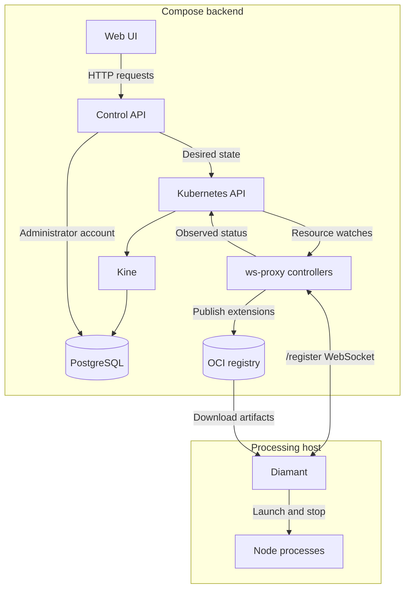
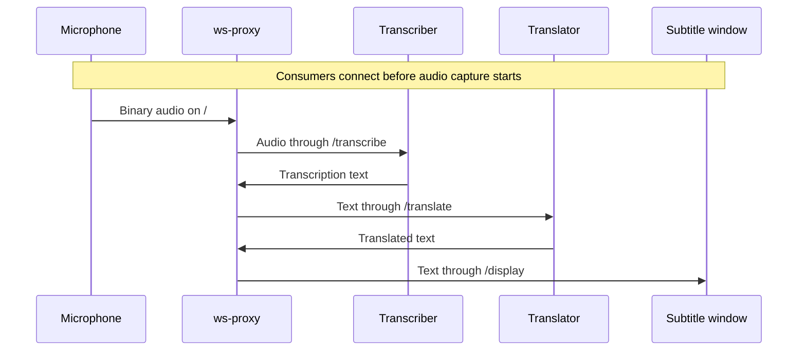

# Architecture

Suntitle has two main flows: live audio and text travel through a WebSocket
relay; configuration and runtime status travel through the control API,
Kubernetes resources, and host agents.

## Components

| Component | Responsibility |
| --- | --- |
| Web UI | Manage hosts, nodes, and extensions through the HTTP API |
| `control-api` | Authenticate users, validate requests, and persist desired resource state |
| `ws-proxy` | Relay audio/text, manage host sessions, reconcile resources, and publish extensions |
| Diamant | Register a host, prepare extensions, and own node processes |
| Python nodes | Capture audio, transcribe with Whisper, translate, and display subtitles |
| Kubernetes API + Kine | Validate and store host, node, and extension resources in PostgreSQL |
| Distribution | Store published extension payloads as OCI artifacts |
| Traefik | Route browser, API, WebSocket, and registry traffic |

The standalone Kubernetes API provides resource storage and watches. This stack
does not run a scheduler, controller-manager, or Kubernetes workers. Diamant
launches processing nodes as host processes.

## Desired state and observed state

The API writes resource specifications. A successful HTTP write means the desired
state was persisted; controllers and Diamant apply it asynchronously. Resource
status records what happened, including the observed generation and conditions.
Clients must check status before treating a requested change as applied.

Hosts identify registered machines, nodes describe processing instances, and
extensions describe custom execution adapters and payload sources. Nodes refer
to hosts and optional extensions by resource name. Kubernetes UIDs distinguish
deleted and recreated resources; host session IDs distinguish reconnects.

The proxy reconciles desired nodes against active sessions. Diamant downloads
and prepares custom artifacts before launching them. Disconnecting a host marks
it offline while keeping desired nodes. Finalizers defer deletion until dependent
nodes and runtime work are cleaned up. See [internals](internals.md) for the
lifecycle and source map.

## Live data flow

The microphone sends binary audio to `/`. Transcribers receive it through
`/transcribe` and return text. Translators receive that text on `/translate` and
send translated text to displays on `/display`.

The relay forwards messages to connected clients without replaying past data.
Start consumers before producers. The standalone translator currently uses the
Ukrainian-to-Czech `Helsinki-NLP/opus-mt-uk-cs` model. Protocol entry points are in
[contracts](contracts.md#websocket-data-plane).

## Storage and persistence

| Store | Contents | Lifetime |
| --- | --- | --- |
| PostgreSQL volume | Kine resource state and the administrator account | Retained across ordinary Compose shutdown |
| Registry volume | Published extension payloads | Retained independently of resource state |
| Diamant artifact directory | Downloaded payloads on each host | Completed payloads retained; automatic garbage collection deferred |
| Host session and API token memory | Active connections and bearer sessions | Rebuilt after service restart |

Database backups do not contain registry payloads. See
[backup and restore](local-development.md#backup-and-restore).

## Deployment boundaries

In the local stack, Compose runs the gateway, UI, API, proxy/controller,
Kubernetes API, Kine, PostgreSQL, and registry. Diamant runs on the host so its
nodes can access local audio devices and the desktop.

Only Traefik publishes a port by default: HTTP on port 80. `/api` routes to the
control API; `/register`, `/transcribe`, `/translate`, `/display`, and root audio
WebSocket connections route to the proxy. Normal page requests and Vite hot
reload route to the UI. `registry.localhost` routes to Distribution.

The [host-service development overlay](local-development.md#run-services-on-the-host)
publishes PostgreSQL and Kubernetes on loopback for local applications and tests.
[AWS deployment](../infrastructure/README.md) runs the Compose backend on EC2;
Diamant and processing nodes run on client hosts. The registry authority must be
reachable from those hosts.
