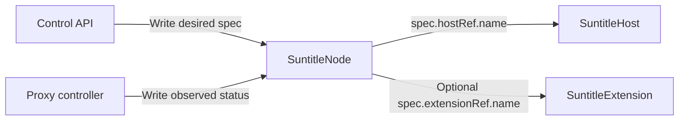

# Contracts

Use the checked-in schemas and shared Rust types for exact fields and wire
formats. This guide explains their boundaries and how to update them.

| Contract | Definition |
| --- | --- |
| HTTP Control API | [`specs/openapi.yaml`](../specs/openapi.yaml) |
| HTTP handlers and OpenAPI annotations | [`control-api/src/api/`](../control-api/src/api/) |
| Kubernetes resource types | [`suntitle-core/src/kubernetes/resources.rs`](../suntitle-core/src/kubernetes/resources.rs) |
| Generated CRDs | [`kubernetes/crds.yaml`](../kubernetes/crds.yaml) |
| Adapter and execution types | [`adapter.rs`](../suntitle-core/src/kubernetes/adapter.rs), [`execution.rs`](../suntitle-core/src/kubernetes/execution.rs) |
| Host registration and dispatch | [`suntitle-core/src/registration.rs`](../suntitle-core/src/registration.rs) |
| API fixtures | [`mockserver/`](../mockserver/README.md) |

## HTTP Control API

The base path is `/api/v1`. In Compose, access it through
`http://localhost/api/v1`; a host-run API defaults to port 3031.

Log in with `POST /auth/login` and send the returned access token as
`Authorization: Bearer <token>` on protected requests. Sessions last 24 hours;
logout or an API restart revokes them. PostgreSQL stores the singleton
administrator with a salted scrypt password hash. Bootstrap credentials create
the account only when it does not exist.

| Area | Operations relative to `/api/v1` |
| --- | --- |
| Authentication | `POST /auth/login`, `POST /auth/logout`, `GET /auth/me` |
| Hosts | `GET /hosts`, `POST /hosts/{name}/nodes` |
| Nodes | `GET /nodes`, `GET /nodes/{name}`, `PUT /nodes/{name}`, `DELETE /nodes/{name}`, `POST /nodes/{name}/restart` |
| Node types | `GET /node-types` |
| Extensions | `GET /extensions`, `POST /extensions`, `GET /extensions/{name}`, `POST /extensions/{name}/refresh` |

Resource paths use Kubernetes resource names. Responses flatten the resource
spec alongside `name` and `status`. Collection responses include `items` and an
opaque `resourceVersion`. Node updates supply the complete editable spec;
metadata and status are preserved. Restart and refresh requests return 202 and
change a token to trigger reconciliation.

Writes persist desired state. They do not wait for installation or process
startup. Compare the resource generation with `status.observedGeneration` and
inspect conditions before treating status as current.

Kubernetes validates resource schemas and CEL rules. Upstream API-server errors
preserve their HTTP status, reason, message, and details in the error envelope;
transport failures return 503. The API also exposes `/readyz` outside `/api/v1`
to check access to the required resources.

## Kubernetes resources

The API group is `control.suntitle.io/v1alpha1`; the default namespace is
`suntitle`. The kinds are `SuntitleHost`, `SuntitleNode`, and `SuntitleExtension`.



`spec` holds desired configuration. Controllers write observed state through
the status subresource. `displayName` is a human-readable label; resource names
are identities. Node host references use `spec.hostRef.name`. Custom nodes also
reference an extension through `spec.extensionRef.name`.

Built-in settings use one externally tagged key: `audio_source`, `transcriber`,
`translator`, or `display`. For example:

```yaml
settings:
  transcriber:
    model: small
    language: en
```

The node's host and type are immutable. The CRDs define defaults, nullable fields,
validation, and status condition schemas. Finalizer management belongs to the
controller; deleting a resource can remain pending while host cleanup is deferred.

Bootstrap installs the namespace, CRDs, and separate API/proxy RBAC identities.
Application identities cannot install CRDs or RBAC. See
[`kubernetes/rbac.yaml`](../kubernetes/rbac.yaml) for exact permissions and
[local development](local-development.md#host-access-to-kubernetes-and-postgresql)
for bootstrap commands and connectivity.

## Extension adapters

Registration accepts a source type and location and discovers its manifest.
The adapter declares execution, settings, and ordered argument bindings. Runtime
values are `executable` (the default), `python`, and `pythonModule`; `command`
means an executable path, script path, or importable module respectively.

Node overrides take precedence over extension defaults. Missing required settings
prevent resolution. Bindings select a direct source or compose an endpoint path
with `runtime.websocketUrl`. Setting strings pass through unchanged, without
shell evaluation or interpolation. Optional media types describe the adapter's
input/output; they do not select execution behavior or endpoints.

See [extensions](extensions.md) for source layouts, publication, and installation,
and the shared adapter types for validation details.

## WebSocket data plane

| Route | Client | Receives | Sends |
| --- | --- | --- | --- |
| `/` | `suntitle-listener.py` | — | Microphone audio |
| `/transcribe` | `whisper_online_client.py` | Audio | Transcription text |
| `/translate` | `suntitle-translator.py` | Transcription text | Translated text |
| `/display` | `suntitle.py` | Translated text | — |

These routes belong to `ws-proxy`, whose direct default port is 3030.
Traefik exposes them on port 80 in Compose. Audio uses binary frames; the
downstream text stages use text frames. Start consumers first because the relay
does not replay messages. See [`ws-proxy/src/main.rs`](../ws-proxy/src/main.rs)
and the [relay probe](../ws-proxy/examples/e2e_probe.rs) for behavior.

## Host registration and dispatch

Diamant uses a separate WebSocket connection at `/register`. Messages use an
envelope with `protocolVersion: 1`, a snake_case `type`, and camelCase fields.

| Direction | Message types |
| --- | --- |
| Agent → hub | `register`, `heartbeat`, `acknowledgement` |
| Hub → agent | `registered`, `apply`, `download_artifact`, `remove`, `error` |

```mermaid
sequenceDiagram
    participant Agent as Diamant
    participant Hub as Proxy controller
    participant K8s as Kubernetes API
    Agent->>Hub: register
    Hub->>K8s: Resolve host resource
    Hub-->>Agent: registered with host identity and sessionId
    loop While connected
        Agent->>Hub: heartbeat with hostUid and sessionId
    end
    K8s-->>Hub: Desired node change
    Hub->>Agent: apply with revision and operation identity
    Agent->>Agent: Apply node configuration
    Agent-->>Hub: acknowledgement with matching identity
    Hub->>K8s: Update observed status
    Note over Agent,Hub: Reconnect opens a new session; stale acknowledgements are rejected
```

The sequence shows a successful apply. Heartbeats continue while work runs;
custom nodes can require `download_artifact` before `apply`.

Registration resolves a host resource and opens a session. Commands and
acknowledgements carry resource, host, session, generation, restart, and operation
identity. Stale acknowledgements must not complete work for another revision or
session. A custom apply includes an immutable artifact reference and resolved
adapter. Download/preparation and process launch are separate operations.

The shared registration types define the exact payloads. See
[internals](internals.md#reconciliation-and-lifecycle) for ordering and terminal
or deferred states.

## Updating generated contracts

After changing the HTTP annotations or shared resource types, regenerate the
corresponding checked-in contract:

```bash
cargo run -p control-api --bin generate_openapi
just generate-crds
```

Neither generation command requires a running Kubernetes server or database.
`just test-rust` includes the OpenAPI consistency check. With live dependencies
prepared, `just kubernetes-test` checks resource validation and RBAC; the ignored
Rust integration tests exercise real resource handlers. See
[verification](local-development.md#verification) for setup.
