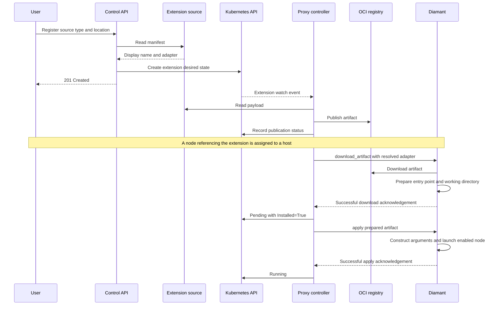

# Extensions

See [contracts](contracts.md) for the resource and adapter definitions, and
[architecture](architecture.md) for component responsibilities.

## Extension artifact registry

For your own local extensions, put each payload in `extensions/<name>/` and register
it with `sourceType: local` and `source: /opt/suntitle/extensions/<name>`.
The registration dialog asks for source type and path or URL. Registration persists
that intent without fetching it. The backend controller reads `manifest.yaml`,
`manifest.yml`, or `manifest.json` asynchronously and reports preparation failures
through extension status. The manifest contains `displayName` and `adapter`
(input/output media types, execution, arguments, and settings); a standalone spec,
`{name, spec}` request, or full `SuntitleExtension` resource is accepted. The selected
source overrides its source fields. Retry limits and refresh tokens belong to the
registered resource. Local and Git sources use a root manifest; HTTP payload URLs
use a sibling manifest. Git requires an accessible HTTP(S) repository.

OCI registration supplies the binary artifact reference in `source` and YAML/JSON
contents in a separate `manifest` attribute. The controller parses those contents
without searching the artifact. Transfers use the controller's credentials and
`EXTENSION_REGISTRY_PLAIN_HTTP=true` for local HTTP registries; HTTPS remains the
default outside Compose.

For a local payload in `extensions/hello/`, select **Local** and enter
`/opt/suntitle/extensions/hello`. Supply a manifest alongside the payload;
the controller reads it asynchronously. Unresolved manifests are not offered as node
types. Publication and installation are asynchronous.
Registered extensions appear alongside built-in choices in the host dialog’s
**Node type** selector. Their settings and defaults come from the manifest.

Compose mounts that directory read-only into the proxy/controller (HUB). Set `LOCAL_EXTENSIONS_DIR` in
`.env.local` to use another host directory. Its contents are ignored by Git.
The bundled E2E fixtures are available separately at
`/opt/suntitle/example-extensions/{native,python-script,python-module}`.

Distribution 3 stores OCI artifacts in the persistent `registry-data` volume,
independently of Kubernetes. Traefik routes `registry.localhost` to its private
port 5000. Set `REGISTRY_HOST` in `.env.local` to override the hostname. Clients
MUST use that reachable authority in artifact references, for example
`registry.localhost/suntitle/extensions/example:smoke`.

Traefik depends on the registry, API, proxy, and UI being healthy. Starting it
also starts those services and their dependencies. After completing the [local setup](local-development.md#compose-stack),
check the OCI API:

```bash
docker compose --env-file .env.local up -d --wait
curl --resolve registry.localhost:80:127.0.0.1 -fsS http://registry.localhost/v2/
```

With ORAS installed, verify artifact push and pull through Traefik:

```bash
(
  cd "$(mktemp -d)"
  printf 'registry smoke test\n' > smoke.txt
  oras push --plain-http registry.localhost/suntitle/extensions/example:smoke \
    smoke.txt:text/plain
  oras pull --plain-http registry.localhost/suntitle/extensions/example:smoke \
    --output pulled
  cmp smoke.txt pulled/smoke.txt
)
```

The local endpoint uses HTTP without authentication. Deployed environments MUST
configure HTTPS and authentication at Traefik or Distribution, use a hostname
reachable by assigned Diamant hosts, and pin a tested registry patch version or
image digest. Changing `REGISTRY_HOST` alone does not enable TLS or authentication.
Back up `registry-data`; container replacement and ordinary Compose shutdown
preserve it. `docker compose down --volumes` (including `just db-drop-volume`)
also erases registry artifacts.

## Publication and host installation



The sequence shows the successful enabled-node path. Preparation and launch
failures report `Failed`; disabled apply reports `Disabled`.

Once an extension has a published artifact reference for its current generation,
HUB resolves it into `SuntitleNode.status.artifactReference`. Diamant receives a
`download_artifact` command and downloads from that reference using `oci-artifact`.
The reference contains the registry and repository; the client supplies the standard
OCI `/v2/` API path. No registry suffix needs configuration. Published digest
references are preferred so the downloaded content is immutable.

Downloads use anonymous access and verified HTTPS by default. For the local
Compose registry, run Diamant with `--artifact-plain-http` or
`ARTIFACT_PLAIN_HTTP=true`. Artifact storage is configured with
`--artifact-dir` or `ARTIFACT_DIR`. The default is the OS local data directory:

- Linux: `$XDG_DATA_HOME/suntitle/diamant/artifacts`, normally
  `~/.local/share/suntitle/diamant/artifacts`.
- macOS: `~/Library/Application Support/suntitle/diamant/artifacts`.

Each operation downloads into a private staging directory and publishes a unique
payload directory only after success. Download reports include its absolute path.
Failed or cancelled downloads clean up staging. Completed payloads are retained;
automatic cache reuse and garbage collection are deferred. Reconnecting downloads
the current artifact again. Storage is independent of the Python project directory.

Downloads run in the background so heartbeats continue. Removal, replacement,
disconnect, and shutdown cancel outstanding work and await renderer cleanup.
Reports are checked against node, generation, operation, artifact, and host session.

After download, Diamant resolves the entry point and working directory. Successful
preparation leaves the node `Pending` with `Installed=True` and
`Ready=False`/`Updated=False` while launch is pending. A later custom `apply`
constructs arguments and starts the process. Only successful launch reports
`Running`; preparation or launch failures report `Failed`. See
[the lifecycle implementation](../ws-proxy/src/controller/lifecycle.rs).

Git extension sources use HTTP or HTTPS through `gix` and rustls. Each preparation
fetches default `HEAD` at depth one into a private temporary bare repository, then
streams that commit's files into the extension artifact without a working checkout.
The temporary repository is removed when packaging finishes or fails. Cancellation
interrupts fetching and waits for cleanup. SSH, Git submodules, and Git LFS content
resolution are deferred. The application does not invoke external Git or SSH tools.

See the [OCI client guide](../oci-artifact/README.md) and
[custom-node E2E fixtures](../ws-proxy/examples/custom_node_e2e/README.md) for
implementation details and runnable extension examples.
