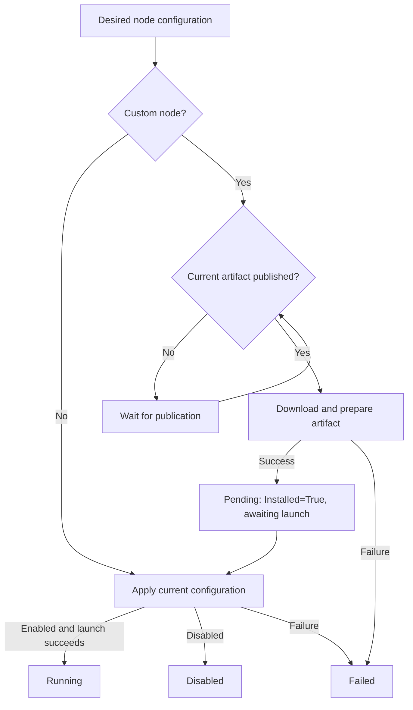
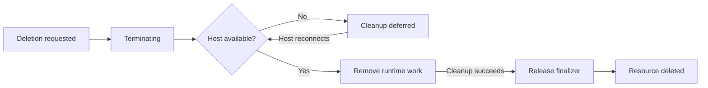

# Internals

Read [architecture](architecture.md) for the system overview and
[contracts](contracts.md) for wire formats and resource semantics.

## Source map

| Area | Entry points |
| --- | --- |
| HTTP handlers and authentication | [`control-api/src/api/`](../control-api/src/api/) |
| Kubernetes persistence | [`control-api/src/store.rs`](../control-api/src/store.rs) |
| Relay and registration endpoint | [`ws-proxy/src/main.rs`](../ws-proxy/src/main.rs) |
| Reconciliation and publication | [`ws-proxy/src/controller/`](../ws-proxy/src/controller/) |
| Shared resources and adapter resolution | [`suntitle-core/src/kubernetes/`](../suntitle-core/src/kubernetes/) |
| Host protocol | [`suntitle-core/src/registration.rs`](../suntitle-core/src/registration.rs) |
| Agent connection and command handling | [`diamant/src/main.rs`](../diamant/src/main.rs) |
| Artifact download and preparation | [`diamant/src/artifacts.rs`](../diamant/src/artifacts.rs), [`installation.rs`](../diamant/src/installation.rs) |
| Process ownership and argument construction | [`diamant/src/nodes.rs`](../diamant/src/nodes.rs) |
| Python processing nodes | [`suntitle-listener.py`](../default-extensions/suntitle-listener.py), [`whisper_online_client.py`](../default-extensions/whisper_online_client.py), [`suntitle-translator.py`](../default-extensions/suntitle-translator.py), [`suntitle.py`](../default-extensions/suntitle.py) |

## Reconciliation and lifecycle



This shows initial application. Configuration changes can reuse the installed
artifact; a changed artifact requires preparation again.

The API persists desired state. Controllers watch resources and dispatch work to
the active host session. Acknowledgements identify the resource UID, generation,
restart token, operation, and session so stale reports cannot complete newer work.
See [`plan.rs`](../ws-proxy/src/controller/plan.rs),
[`dispatch.rs`](../ws-proxy/src/controller/dispatch.rs), and
[`lifecycle.rs`](../ws-proxy/src/controller/lifecycle.rs).

For a custom node, extension publication precedes artifact download and entry-point
preparation. Preparation reports `Installed=True` while launch remains pending.
A subsequent apply constructs arguments and starts the process; successful enabled
apply reports `Running`, and disabled apply reports `Disabled`. Preparation or
apply failures report `Failed`.

Removal remains `Terminating` until runtime cleanup releases the finalizer.
Deleting a host or extension first deletes its dependent nodes. Offline hosts can
defer that cleanup. Desired nodes survive a host disconnect and are reconciled
when it reconnects. See [`gc.rs`](../ws-proxy/src/controller/gc.rs) and
[`session.rs`](../ws-proxy/src/controller/session.rs).



On Unix, Diamant starts each node in its own process group. Shutdown sends
SIGTERM, waits for the grace period, and uses SIGKILL if needed. Artifact work is
cancelled and awaited on removal, replacement, disconnect, and shutdown.

## Diamant configuration

Diamant is its own Rust package. Its default build opens the desktop UI;
`diamant --cli` runs headless. A pure CLI build uses `--no-default-features`.

The host name defaults to the operating system hostname and can be overridden
with `--host-name` or `HOST_NAME`. The proxy URL can be set with
`--proxy-url` or `PROXY_URL`. Diamant detects the routed host IP by
default; use `--host-ip` or `HOST_IP` to override it.

The proxy resolves the host name to a Kubernetes host resource and returns its
UID. Diamant reports health every 30 seconds and reconnects when the connection
ends. The health interval can be changed with `--health-interval-seconds` or
`HEALTH_INTERVAL_SECONDS`.

The desktop window is the default Diamant build:

```bash
cargo build -p diamant --bin diamant
```

The default build opens the desktop window; `diamant --cli` runs headless.
The window stores connection settings locally, connects to the hub on demand,
and shows the nodes running on the host with their command parameters.
The desktop fields map to the same CLI options. `diamant uv ...` remains
available in both builds for invoking the embedded uv CLI.

The desktop window uses `eframe` and is compiled into the Diamant
executable. GUI builds do not require Qt or another separately installed UI
runtime. Releases publish directly runnable GUI executables for Linux x86-64,
Windows x86-64, and both Apple Silicon and Intel macOS. A separate pure CLI
build is available with `--no-default-features` and is published with a
`diamant-cli` asset name.

Host identity, health, desired nodes, and dispatch status persist in Kubernetes resources.
Disconnected hosts become offline; missing health reports expire after 45 seconds,
so configure the health interval below that limit. Nodes remain available through
the API while the host is offline. CI publishes the GUI as the primary
`diamant.<platform>` executable and the headless agent separately as
`diamant-cli.<target>.tar.xz`.

GUI release assets use platform-specific names such as
`diamant.windows-x86_64.exe`, `diamant.linux-x86_64`, and
`diamant.macos-aarch64`. They are single executables rather than installers or
archives. Linux and macOS users may need to preserve or restore the executable
permission when downloading through a browser. Unsigned macOS development
builds may also require the standard Gatekeeper confirmation.

See [extensions](extensions.md#publication-and-host-installation) for artifact
storage and download behavior.

## Workspace, builds, and releases

The repository root contains the Cargo workspace and its shared `Cargo.lock`.
Build output is written to `target/` at the root.

| Package | Location | Responsibility |
| --- | --- | --- |
| `ws-proxy` | `ws-proxy/` | WebSocket relay and reconciliation controller |
| `control-api` | `control-api/` | HTTP control API, Kubernetes storage, and OpenAPI generation |
| `diamant` | `diamant/` | Host agent, extension installation, and node processes |
| `diamant-ui` | `diamant-ui/` | Native `egui` desktop UI for Diamant |
| `oci-artifact` | `oci-artifact/` | OCI artifact publishing and downloading |
| `suntitle-core` | `suntitle-core/` | Shared models, Kubernetes resources, and registration protocol |

The proxy, API, and agent depend on `suntitle-core`; they are separate executables that communicate over the network. Proxy integration tests use `control-api` as a development
dependency. End-to-end examples remain in `ws-proxy/examples/` and use the
workspace binaries.

```sh
cargo build --locked
cargo test --locked
cargo run -p control-api --bin control_api -- --help
cargo run -p control-api --bin generate_openapi
cargo run -p diamant -- --help
cargo check -p diamant
```

Default workspace commands include the Diamant GUI. Build the pure CLI agent
explicitly with:

```sh
cargo build -p diamant --bin diamant --no-default-features
```

Headless Linux releases use static `x86_64-unknown-linux-musl` binaries for
`ws-proxy`, `control_api`, and `diamant`. The agent is published as
`diamant-cli.x86_64-unknown-linux-musl.tar.xz`. Build and verify the static
artifacts locally with:

```sh
docker build --platform linux/amd64 --file docker/ws-proxy/Dockerfile \
  --target release-artifacts --output type=local,dest=target/static-release .
docker build --platform linux/amd64 --file docker/diamant/Dockerfile \
  --target release-artifact --output type=local,dest=target/diamant-cli-release .
```

The ws-proxy build produces only `ws-proxy` and `control_api`; Diamant is built
independently by its dedicated Dockerfile and GitHub Actions job. The Diamant
build rejects shared libraries and dynamic loaders. The default native GUI is
explicitly disabled for the separate Diamant CLI artifact.

The release workflow publishes separate component images. Rust images use the
compiled release binaries; the UI image builds from the release checkout:

| Component | Image | Default executable |
| --- | --- | --- |
| Control API | `ghcr.io/suntitle/suntitle/control-api:<release-tag>` | `control_api` |
| WebSocket proxy | `ghcr.io/suntitle/suntitle/ws-proxy:<release-tag>` | `ws-proxy` |
| Headless Diamant | `ghcr.io/suntitle/suntitle/diamant:<release-tag>` | `diamant` |
| UI | `ghcr.io/suntitle/suntitle/ui:<release-tag>` | Vite server |

Stable releases update each image's `latest` tag; prereleases publish only their
version tag. Each image contains its component's runtime. The API also serves
Kubernetes bootstrap commands. Local Compose builds the `control-api` and
`ws-proxy` Docker targets independently.
